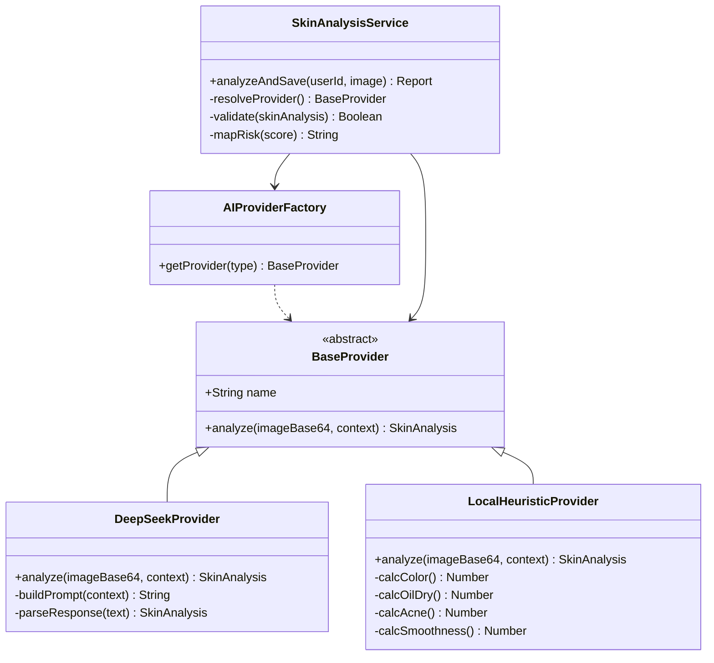
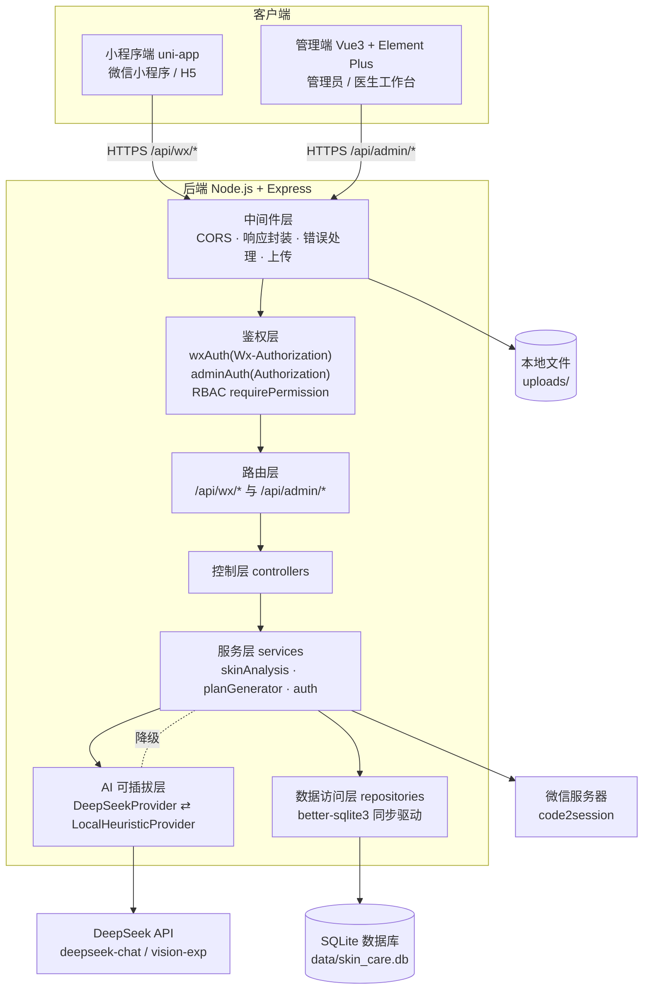
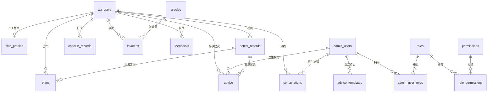
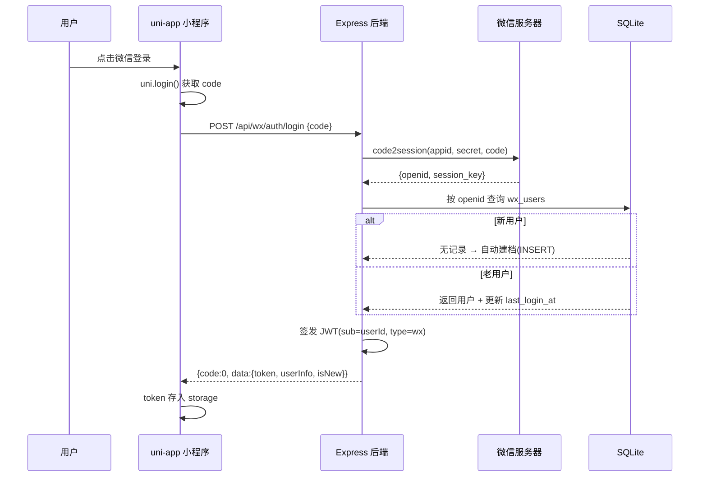
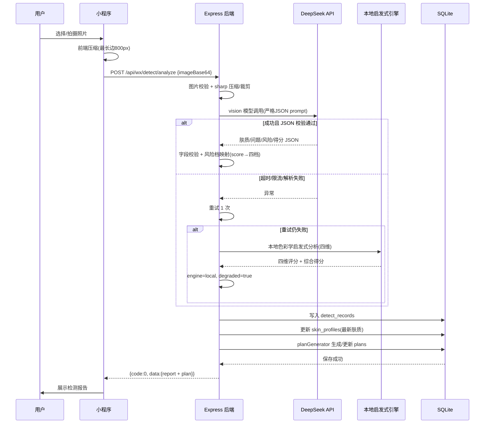
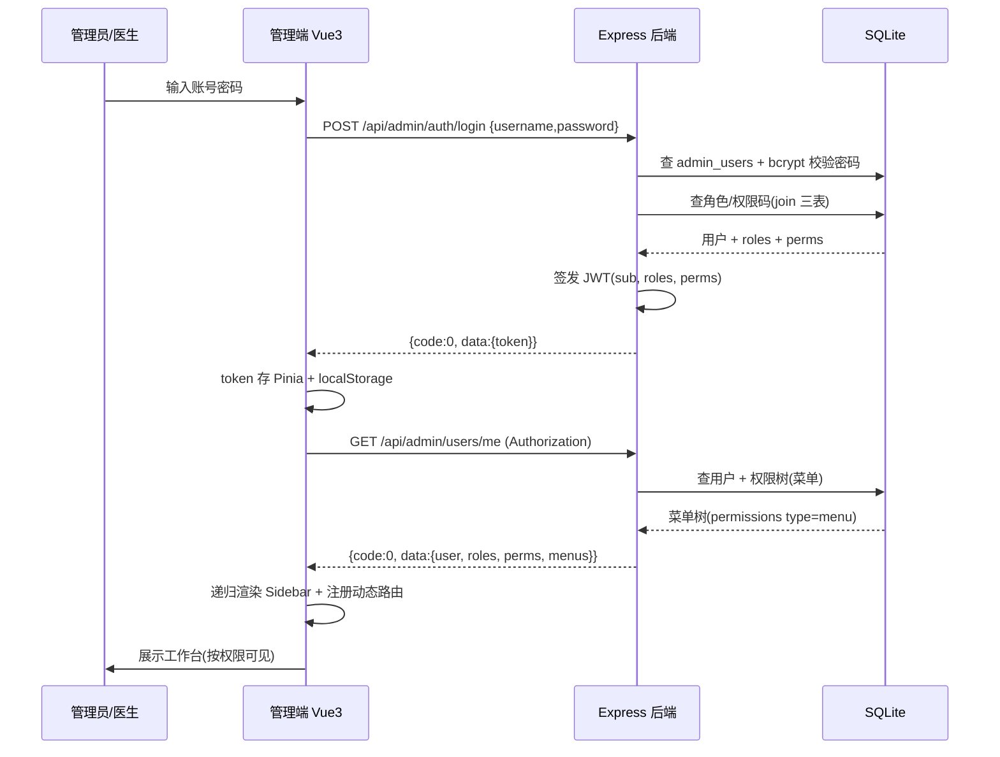

# 系统架构设计文档（ARCHITECTURE）

> 项目：基于 AI 大模型 + 微信小程序的肌肤养护管理系统（智能护肤小程序）
> 代号：`skin_care_system` · 版本：v1.0（MVP）
> 撰写：高见远（架构师）· 状态：交付工程师实现
> 上游依据：`docs/PRD.md`（v1.0）与 `docs/00-项目规划与执行清单.md`

---

## 目录

1. [实现方案与框架选型](#1-实现方案与框架选型)
2. [系统架构图](#2-系统架构图)
3. [目录结构](#3-目录结构)
4. [数据库设计](#4-数据库设计)
5. [接口设计](#5-接口设计)
6. [核心调用流程时序图](#6-核心调用流程时序图)
7. [任务列表](#7-任务列表)
8. [依赖包列表](#8-依赖包列表)
9. [共享知识](#9-共享知识)
10. [待明确事项](#10-待明确事项)

---

## 1. 实现方案与框架选型

### 1.1 分层与技术选型

| 层 | 选型 | 版本建议 | 选型理由 |
|---|---|---|---|
| 运行时 | Node.js | ≥ 18 LTS | 三端同为 JS 技术栈，学习/维护成本最低；Express 生态成熟、轻量、适合 MVP 与毕设落地 |
| Web 框架 | Express | ^4.19 | 中间件模型契合「双鉴权 + RBAC + 统一响应」诉求，路由分组直观 |
| 数据库 | SQLite + `better-sqlite3` | ^11 | 零配置、单文件、同步 API 简化事务与 DAO 编写；SQL 方言兼容 MySQL（`AUTOINCREMENT`→`AUTO_INCREMENT`、`TEXT`→`VARCHAR` 迁移平滑），满足可迁移要求 |
| 后端语言风格 | CommonJS | — | 使用 `__dirname` 定位 `uploads/`、`data/` 目录最直观，避免 ESM 路径坑 |
| 认证 | `jsonwebtoken` + `bcryptjs` | ^9 / ^2 | JWT 无状态双鉴权；`bcryptjs` 纯 JS 实现，规避原生编译问题 |
| 文件上传 | `multer` | ^1.4 | multipart 上传标准方案；AI 检测图额外支持 base64 data URL（DeepSeek 视觉入参要求） |
| 图片压缩 | `sharp` | ^0.33 | 高性能图片压缩/裁剪（最长边 800px、JPEG），控成本（备选纯 JS `jimp`，若原生依赖安装失败可降级） |
| 调外部 API | `axios` + `openai` | ^1.7 / ^4.67 | `axios` 调微信 `code2session`；`openai` 官方 SDK 对接 DeepSeek（OpenAI 兼容） |
| 参数校验 | `express-validator` | ^7 | 声明式校验，减少手写样板代码 |
| 管理端 | Vue3 + Vite + Element Plus + Vue Router + Pinia + ECharts | 见 §8 | 官方模板默认 TS；Element Plus 后台组件完备；ECharts 满足看板三类图表；Pinia 管 token/菜单/权限 |
| 小程序端 | uni-app（Vue3 + Vite） | 3.0.x | 一套代码编译微信小程序 + H5；`uni.login` 天然对接微信登录；`@qiun/ucharts` 绘制趋势曲线 |
| AI 层 | 可插拔 Provider（DeepSeek 默认 / 本地启发式兜底） | — | 见 §1.2 |

### 1.2 AI 层选型（本项目重点）

先说难点。DeepSeek 视觉模型是实验版（`deepseek-v4-flash-vision-exp`），返回要求严格 JSON，请求本身还有成本、限流和超时的风险。所以无 Key、离线、调用失败这三种情况，都得让系统照常能用。

做法是可插拔 Provider 加一层编排降级。



几条约定：

1. Provider 接口统一。所有 Provider 都实现 `analyze(imageBase64, context) → Promise<SkinAnalysis>`，返回同一个结构（§9.4 AI JSON Schema）。以后要接新模型，写一个 Provider 类注册进工厂就行。
2. 工厂策略。`AIProviderFactory.getProvider(type)` 的 `type` 取 `auto | deepseek | local`，由环境变量 `AI_PROVIDER` 控制，默认 `auto`。`auto` 的含义是：有 `DEEPSEEK_API_KEY` 就走 DeepSeek，没有就用本地。
3. 视觉模型名做成配置项。`deepseek-v4-flash-vision-exp` 只出现在 `.env` 的 `DEEPSEEK_VISION_MODEL` 里，不要硬编码进业务代码（模型名带 `exp`，随时可能换）。文本模型 `DEEPSEEK_CHAT_MODEL=deepseek-chat` 同理。
4. 降级链（详见 §6.2 时序图）。DeepSeek 调用遇到超时、限流或异常，重试 1 次；仍然失败，或者返回解析不了、字段校验不过，就降级到 `LocalHeuristicProvider`，返回时带上 `engine:'local'` 和 `degraded:true` 标记。
5. 图片先处理再送模型。上传后先用 `sharp` 压缩（最长边 800px、JPEG q80），再校验尺寸、大小和格式（JPEG/PNG/GIF/WebP）。过大或画质异常的直接拦掉，返回业务错误码（对应 PRD 待确认 #3）。
6. 结构化输出。prompt 里写明只返回 JSON，不要 Markdown 代码块；服务端拿到后 `JSON.parse`，再校验字段（`skinType/score/riskLevel/dimensions/issues` 必填、类型正确、分数 0–100），不通过就走重试或降级。

### 1.3 架构模式

- 后端走分层架构（路由 → 控制器 → 服务 → 数据访问仓库）。不上重型 ORM，DAO 直接用 `better-sqlite3` 的预编译语句，写起来简单，也好测。
- 管理端是 MVVM（Vue3 Composition API + Pinia），配动态路由和 RBAC 路由守卫。
- 小程序端同样是 MVVM（uni-app 页面 + Pinia），请求统一封装。

---

## 2. 系统架构图



---

## 3. 目录结构

> 根目录 `skin_care_system/`，三端平级：`server/`（后端）、`admin-web/`（管理端）、`miniapp/`（小程序端），`docs/` 放文档。

```
skin_care_system/
├── docs/                          # 项目文档（PRD、规划、本架构文档）
│   ├── PRD.md
│   ├── 00-项目规划与执行清单.md
│   └── ARCHITECTURE.md
├── README.md                      # 三端启动指引（联调阶段产出）
│
├── server/                        # ============ 后端 ============
│   ├── package.json
│   ├── .env.example               # 环境变量模板（含 DEEPSEEK_API_KEY 等）
│   ├── .gitignore
│   ├── data/                      # SQLite 数据库文件（运行时生成，gitignore）
│   ├── uploads/                   # 上传图片（运行时生成，gitignore）
│   └── src/
│       ├── server.js              # 启动入口：创建 HTTP 服务、监听 PORT
│       ├── app.js                 # Express 应用装配：中间件、路由、错误处理
│       ├── config/
│       │   ├── index.js           # 读取 .env，导出统一配置对象
│       │   └── database.js        # better-sqlite3 连接 + 执行 schema.sql + seed
│       ├── db/
│       │   ├── schema.sql         # 全部建表语句（含索引、外键）
│       │   └── seed.js            # 种子数据：角色/权限/账号/字典
│       ├── middlewares/
│       │   ├── response.js        # res.ok() / res.fail() 统一响应封装
│       │   ├── errorHandler.js    # 统一异常处理（兜底 500 + 业务错误）
│       │   ├── authWx.js          # 小程序 JWT 校验（Wx-Authorization）
│       │   ├── authAdmin.js       # 后台 JWT 校验（Authorization）
│       │   ├── requirePermission.js # RBAC 接口级鉴权 requirePermission('code')
│       │   └── upload.js          # multer 上传 + 图片校验/压缩（调 imageUtils）
│       ├── utils/
│       │   ├── jwt.js             # JWT 签发/校验（wx/admin 两类 payload）
│       │   ├── bcrypt.js          # 密码哈希/比对
│       │   ├── wechat.js          # code2session 换 openid
│       │   ├── logger.js          # 简单日志（morgan + console）
│       │   └── helper.js          # 分页、ID 生成、时间戳、对象深拷
│       ├── services/
│       │   ├── ai/
│       │   │   ├── index.js               # AIProviderFactory 工厂
│       │   │   ├── baseProvider.js        # 抽象基类
│       │   │   ├── deepseekProvider.js    # DeepSeek（openai SDK + 视觉模型）
│       │   │   ├── localHeuristicProvider.js # 本地色彩学启发式引擎（四维）
│       │   │   └── imageUtils.js          # 图片压缩/裁剪/尺寸校验
│       │   ├── skinAnalysis.js    # 编排：上传→AI(降级)→解析→落库→方案
│       │   ├── planGenerator.js   # 按肤质/问题生成个性化方案
│       │   └── authService.js     # 登录编排（微信/后台）
│       ├── repositories/          # 数据访问层（better-sqlite3 预编译语句）
│       │   ├── baseRepo.js        # 通用 run/get/all/paginate 助手
│       │   ├── wxUserRepo.js
│       │   ├── adminUserRepo.js
│       │   ├── rbacRepo.js        # roles/permissions/role_permissions/admin_user_roles
│       │   ├── skinProfileRepo.js
│       │   ├── detectRecordRepo.js
│       │   ├── checkinRepo.js
│       │   ├── skinDictRepo.js
│       │   ├── planRepo.js
│       │   ├── articleRepo.js
│       │   ├── productRepo.js
│       │   ├── noticeRepo.js
│       │   ├── favoriteRepo.js
│       │   ├── feedbackRepo.js
│       │   ├── consultationRepo.js
│       │   ├── adviceRepo.js
│       │   └── adviceTemplateRepo.js
│       ├── controllers/
│       │   ├── wx/                # 小程序端控制器
│       │   │   ├── authController.js
│       │   │   ├── userController.js
│       │   │   ├── skinProfileController.js
│       │   │   ├── detectController.js
│       │   │   ├── planController.js
│       │   │   ├── checkinController.js
│       │   │   ├── contentController.js
│       │   │   └── consultController.js
│       │   └── admin/             # 管理端/医生端控制器
│       │       ├── authController.js
│       │       ├── userController.js
│       │       ├── rbacController.js
│       │       ├── dashboardController.js
│       │       ├── contentController.js
│       │       ├── skinDictController.js
│       │       ├── feedbackController.js
│       │       ├── detectRecordController.js
│       │       ├── patientController.js
│       │       ├── adviceTemplateController.js
│       │       └── consultController.js
│       └── routes/
│           ├── wxRoutes.js        # /api/wx/*（先挂 authWx）
│           ├── adminRoutes.js     # /api/admin/*（先挂 authAdmin + RBAC）
│           └── index.js           # 聚合挂载到 app
│
├── admin-web/                     # ============ 管理端 ============
│   ├── package.json
│   ├── vite.config.ts
│   ├── tsconfig.json
│   ├── index.html
│   ├── .env.development           # VITE_API_BASE_URL
│   ├── .env.production
│   └── src/
│       ├── main.ts                # 挂载 Vue + Element Plus + Pinia + Router
│       ├── App.vue
│       ├── api/
│       │   ├── request.ts         # axios 实例 + 请求/响应拦截器（注入 Token）
│       │   ├── auth.ts
│       │   ├── user.ts
│       │   ├── rbac.ts
│       │   ├── dashboard.ts
│       │   ├── content.ts         # 文章/产品/公告
│       │   ├── skinDict.ts
│       │   ├── feedback.ts
│       │   ├── detectRecord.ts
│       │   ├── patient.ts
│       │   ├── advice.ts
│       │   └── consult.ts
│       ├── router/
│       │   ├── index.ts           # 静态路由 + 动态路由注册
│       │   └── guard.ts           # 路由守卫（登录校验 + 权限校验）
│       ├── store/
│       │   ├── index.ts           # Pinia 实例
│       │   ├── user.ts            # token/用户信息/角色/权限码
│       │   └── permission.ts      # 菜单树 + 动态路由
│       ├── layout/
│       │   ├── index.vue          # 整体布局
│       │   ├── Sidebar.vue        # 递归渲染动态菜单
│       │   ├── Navbar.vue         # 顶栏（用户/退出）
│       │   └── SidebarItem.vue    # 递归菜单项组件
│       ├── views/
│       │   ├── login/index.vue
│       │   ├── dashboard/index.vue    # ECharts 看板
│       │   ├── users/index.vue        # 用户管理（含顾问账号）
│       │   ├── rbac/index.vue         # 角色/权限配置
│       │   ├── content/article.vue
│       │   ├── content/product.vue
│       │   ├── content/notice.vue
│       │   ├── skin-dict/index.vue
│       │   ├── feedback/index.vue
│       │   ├── detect-records/index.vue
│       │   └── doctor/
│       │       ├── index.vue          # 医生工作台首页
│       │       ├── patient.vue        # 患者完整档案 + 建议撰写
│       │       └── consultations.vue  # 咨询预约处理
│       ├── components/            # 通用组件（分页、上传等）
│       └── styles/
│           └── index.scss
│
└── miniapp/                       # ============ 小程序端（uni-app）============
    ├── package.json
    ├── vite.config.ts
    ├── index.html                 # H5 入口
    └── src/
        ├── main.ts
        ├── App.vue
        ├── pages.json             # 页面路由 + tabBar 配置
        ├── manifest.json          # 应用配置（微信 appid 等）
        ├── uni.scss               # 全局样式变量
        ├── api/
        │   ├── request.ts         # uni.request 封装 + Token 拦截
        │   ├── auth.ts
        │   ├── skin.ts            # 档案/问卷
        │   ├── detect.ts
        │   ├── plan.ts
        │   ├── checkin.ts
        │   └── content.ts
        ├── store/
        │   ├── index.ts           # Pinia 实例
        │   └── user.ts            # token/用户信息
        ├── utils/
        │   ├── image.ts           # 前端图片压缩（canvas，最长边 800px）
        │   └── auth.ts            # token 存取（storage）
        ├── components/            # 通用组件（进度环、空态等）
        └── pages/
            ├── home/index.vue
            ├── login/index.vue
            ├── survey/index.vue
            ├── profile/skin.vue
            ├── detect/upload.vue
            ├── detect/result.vue
            ├── plan/index.vue
            ├── checkin/index.vue
            ├── trend/index.vue
            ├── mine/index.vue
            ├── article/list.vue
            ├── article/detail.vue
            └── consult/index.vue
```

---

## 4. 数据库设计

### 4.1 建表要点（全局约定）

- 时间戳一律用 `TEXT` 存 ISO 8601 UTC（`new Date().toISOString()`），每张表都有 `created_at/updated_at`。
- 核心业务表（用户、内容、建议等）加 `deleted_at TEXT` 做软删除，查询默认带 `WHERE deleted_at IS NULL`，不做物理删除。
- SQLite 默认不启用外键约束，连接时用 `PRAGMA foreign_keys = ON` 打开。迁到 MySQL 时保留 `FOREIGN KEY` 声明，方言层面可以平滑迁移。
- 布尔和状态用 `INTEGER`（0/1）或短的 `TEXT` 枚举。
- 复杂结构（问题列表、Routine、四维得分、AI 原始返回）用 `TEXT` 存 JSON 字符串，读出时 `JSON.parse`。
- 外键列和高频筛选列（`openid`、`user_id`、`checkin_date`、`status`、`publish_at`）建索引。

### 4.2 表结构（19 张表）

> 主键统一 `id INTEGER PRIMARY KEY AUTOINCREMENT`。

**① wx_users（小程序用户）**
| 字段 | 类型 | 约束/说明 |
|---|---|---|
| id | INTEGER | PK |
| openid | TEXT | UNIQUE NOT NULL，微信唯一标识 |
| nickname | TEXT | 昵称 |
| avatar_url | TEXT | 头像 |
| gender | TEXT | unknown/male/female |
| birthday | TEXT | 可空 |
| phone | TEXT | 可空（预留绑定） |
| status | INTEGER | 1 正常 / 0 禁用，默认 1 |
| last_login_at | TEXT | — |
| created_at / updated_at / deleted_at | TEXT | 时间戳/软删除 |

索引：`UNIQUE(openid)`、`idx_wx_users_status(status)`。

**② admin_users（后台用户：管理员/医生）**
| 字段 | 类型 | 约束/说明 |
|---|---|---|
| id | INTEGER | PK |
| username | TEXT | UNIQUE NOT NULL |
| password_hash | TEXT | NOT NULL（bcryptjs） |
| real_name | TEXT | 姓名 |
| status | INTEGER | 1 正常 / 0 禁用 |
| last_login_at | TEXT | — |
| created_at / updated_at / deleted_at | TEXT | — |

索引：`UNIQUE(username)`。

**③ roles（角色）**
| 字段 | 类型 | 约束/说明 |
|---|---|---|
| id | INTEGER | PK |
| code | TEXT | UNIQUE NOT NULL，如 `admin`/`doctor` |
| name | TEXT | 显示名 |
| remark | TEXT | 备注 |
| status | INTEGER | 默认 1 |
| created_at / updated_at / deleted_at | TEXT | — |

**④ permissions（权限/菜单/按钮）**
| 字段 | 类型 | 约束/说明 |
|---|---|---|
| id | INTEGER | PK |
| code | TEXT | UNIQUE NOT NULL，如 `system:user:list` |
| name | TEXT | 名称 |
| type | TEXT | menu / button / api |
| parent_id | INTEGER | 菜单树父节点，0 为根 |
| route_path | TEXT | 前端路由路径 |
| component | TEXT | 前端组件路径 |
| icon | TEXT | 菜单图标 |
| sort | INTEGER | 排序 |
| created_at / updated_at | TEXT | — |

**⑤ role_permissions（角色-权限关联）**
| 字段 | 类型 | 约束/说明 |
|---|---|---|
| id | INTEGER | PK |
| role_id | INTEGER | FK → roles.id |
| permission_id | INTEGER | FK → permissions.id |

索引：`UNIQUE(role_id, permission_id)`。

**⑥ admin_user_roles（后台用户-角色关联）**
| 字段 | 类型 | 约束/说明 |
|---|---|---|
| id | INTEGER | PK |
| admin_user_id | INTEGER | FK → admin_users.id |
| role_id | INTEGER | FK → roles.id |

索引：`UNIQUE(admin_user_id, role_id)`。

**⑦ skin_profiles（肌肤档案，1:1 用户）**
| 字段 | 类型 | 约束/说明 |
|---|---|---|
| id | INTEGER | PK |
| user_id | INTEGER | FK → wx_users.id，UNIQUE |
| skin_type | TEXT | 干性/油性/混合/中性/敏感 |
| sensitivity | INTEGER | 敏感度 0–3 |
| concerns | TEXT | JSON 数组（问题自评） |
| habits | TEXT | JSON（生活习惯） |
| photo_url | TEXT | 档案照片 |
| created_at / updated_at / deleted_at | TEXT | — |

索引：`UNIQUE(user_id)`。

**⑧ detect_records（检测记录）**
| 字段 | 类型 | 约束/说明 |
|---|---|---|
| id | INTEGER | PK |
| user_id | INTEGER | FK → wx_users.id |
| image_url | TEXT | 检测图 |
| engine | TEXT | deepseek / local |
| degraded | INTEGER | 是否降级 0/1 |
| skin_type | TEXT | AI 识别肤质 |
| issues | TEXT | JSON 数组（问题列表） |
| risk_level | TEXT | 良好/一般/需关注/高风险 |
| score | INTEGER | 综合得分 0–100 |
| dimensions | TEXT | JSON（肤色/油干性/痤疮/平滑度） |
| raw_report | TEXT | AI 原始返回 JSON |
| report_text | TEXT | 报告文本 |
| created_at | TEXT | — |

索引：`idx_detect_user(user_id)`、`idx_detect_created(created_at)`。

**⑨ checkin_records（打卡记录）**
| 字段 | 类型 | 约束/说明 |
|---|---|---|
| id | INTEGER | PK |
| user_id | INTEGER | FK → wx_users.id |
| checkin_date | TEXT | YYYY-MM-DD |
| cleanse | INTEGER | 0/1 |
| moisturize | INTEGER | 0/1 |
| sunscreen | INTEGER | 0/1 |
| created_at / updated_at | TEXT | — |

索引：`UNIQUE(user_id, checkin_date)`。

**⑩ skin_dict（肌肤数据字典）**
| 字段 | 类型 | 约束/说明 |
|---|---|---|
| id | INTEGER | PK |
| dict_type | TEXT | skin_type/issue/ingredient/risk 等 |
| dict_code | TEXT | 编码 |
| dict_name | TEXT | 名称 |
| dict_value | TEXT | JSON 扩展参数（阈值等） |
| parent_id | INTEGER | 树形，默认 0 |
| sort | INTEGER | 排序 |
| status | INTEGER | 默认 1 |
| remark | TEXT | — |
| created_at / updated_at | TEXT | — |

索引：`UNIQUE(dict_type, dict_code)`。

**⑪ plans（个性化方案生成记录）**
| 字段 | 类型 | 约束/说明 |
|---|---|---|
| id | INTEGER | PK |
| user_id | INTEGER | FK → wx_users.id |
| detect_record_id | INTEGER | FK → detect_records.id，可空 |
| title | TEXT | 方案标题 |
| routine_morning | TEXT | JSON（早间 Routine 步骤数组） |
| routine_evening | TEXT | JSON（晚间 Routine 步骤数组） |
| ingredients | TEXT | JSON（成分建议） |
| taboos | TEXT | JSON（禁忌） |
| status | INTEGER | 1 生效 / 0 历史 |
| created_at / updated_at | TEXT | — |

索引：`idx_plan_user(user_id)`。

**⑫ articles（科普文章）**
| 字段 | 类型 | 约束/说明 |
|---|---|---|
| id | INTEGER | PK |
| title | TEXT | NOT NULL |
| cover_url | TEXT | 封面图 |
| content | TEXT | 富文本（HTML） |
| author | TEXT | 作者 |
| status | INTEGER | 1 发布 / 0 下架 |
| view_count | INTEGER | 默认 0 |
| publish_at | TEXT | 发布时间 |
| created_at / updated_at / deleted_at | TEXT | — |

**⑬ products（护肤产品）**
| 字段 | 类型 | 约束/说明 |
|---|---|---|
| id | INTEGER | PK |
| name | TEXT | NOT NULL |
| image_url | TEXT | 图片 |
| brand | TEXT | 品牌 |
| category | TEXT | 分类 |
| description | TEXT | 描述 |
| ingredients | TEXT | JSON（成分列表） |
| status | INTEGER | 1 上架 / 0 下架 |
| created_at / updated_at / deleted_at | TEXT | — |

**⑭ notices（公告）**
| 字段 | 类型 | 约束/说明 |
|---|---|---|
| id | INTEGER | PK |
| title | TEXT | NOT NULL |
| content | TEXT | 纯文本 |
| status | INTEGER | 1 发布 / 0 下架 |
| publish_at | TEXT | — |
| created_at / updated_at / deleted_at | TEXT | — |

**⑮ favorites（文章收藏）**
| 字段 | 类型 | 约束/说明 |
|---|---|---|
| id | INTEGER | PK |
| user_id | INTEGER | FK → wx_users.id |
| article_id | INTEGER | FK → articles.id |
| created_at | TEXT | — |

索引：`UNIQUE(user_id, article_id)`。

**⑯ feedbacks（用户反馈）**
| 字段 | 类型 | 约束/说明 |
|---|---|---|
| id | INTEGER | PK |
| user_id | INTEGER | FK → wx_users.id |
| content | TEXT | NOT NULL |
| reply | TEXT | 管理员回复 |
| status | INTEGER | 0 待处理 / 1 已回复 |
| created_at / updated_at | TEXT | — |

**⑰ consultations（咨询预约）**
| 字段 | 类型 | 约束/说明 |
|---|---|---|
| id | INTEGER | PK |
| user_id | INTEGER | FK → wx_users.id |
| subject | TEXT | 主题 |
| description | TEXT | 描述 |
| status | TEXT | pending/accepted/completed/cancelled |
| doctor_id | INTEGER | FK → admin_users.id，可空（处理人） |
| reply | TEXT | 医生回复 |
| created_at / updated_at / deleted_at | TEXT | — |

**⑱ advice（专业建议）**
| 字段 | 类型 | 约束/说明 |
|---|---|---|
| id | INTEGER | PK |
| user_id | INTEGER | FK → wx_users.id |
| doctor_id | INTEGER | FK → admin_users.id |
| detect_record_id | INTEGER | FK → detect_records.id，可空 |
| content | TEXT | NOT NULL |
| created_at / updated_at / deleted_at | TEXT | — |

索引：`idx_advice_user(user_id)`。

**⑲ advice_templates（建议模板）**
| 字段 | 类型 | 约束/说明 |
|---|---|---|
| id | INTEGER | PK |
| doctor_id | INTEGER | FK → admin_users.id |
| title | TEXT | NOT NULL |
| content | TEXT | NOT NULL |
| category | TEXT | 分类 |
| created_at / updated_at / deleted_at | TEXT | — |

> 可选（P2）：`operation_logs`（操作日志，A-10）：`id, admin_user_id, action, target, detail(TEXT JSON), ip, created_at`。

### 4.3 E-R 关系



几点关系说明：
- `wx_users` 与 `admin_users` 物理分表、零关联（双鉴权隔离的核心）。
- `admin_users` 与 `roles` 多对多（`admin_user_roles`）；`roles` 与 `permissions` 多对多（`role_permissions`）。
- `permissions` 自关联（`parent_id`）构成菜单/权限树。
- 检测记录生成方案（`plans.detect_record_id`）；医生建议可挂到某次检测记录。

---

## 5. 接口设计

### 5.1 统一响应与鉴权中间件挂载

统一响应结构是 `{ code, msg, data }`，`code = 0` 成功，非 0 失败（错误码见 §9.2）。

路由按双前缀分组，在 `src/routes/index.js` 里聚合：

```js
// app.js 挂载
app.use('/api/wx', wxRoutes);      // 小程序端：Wx-Authorization
app.use('/api/admin', adminRoutes); // 管理端：Authorization + RBAC
```

```js
// wxRoutes.js —— 除登录外全部需 authWx
router.post('/auth/login', authController.login);   // 公开
router.use(authWx);                                  // 其余统一鉴权
router.get('/users/me', userController.getMe);
// ...其余 wx 路由

// adminRoutes.js —— 除登录外全部需 authAdmin + RBAC
router.post('/auth/login', authController.login);    // 公开
router.use(authAdmin);                               // 统一鉴权
router.get('/users/me', authController.me);          // 当前用户 + 菜单树
router.get('/dashboard/summary', requirePermission('dashboard:view'), dashboardController.summary);
// ...其余 admin 路由，按需 requirePermission('xxx:yyy')
```

两端的鉴权头是分开的：
- 小程序端用 `Wx-Authorization: Bearer <token>`，token 签发自 `wx_users`。
- 管理端和医生端用 `Authorization: Bearer <token>`，token 签发自 `admin_users`。
- 两者物理隔离，互不通用，越权或串用一律 401。

### 5.2 关键接口 JSON 示例

#### (1) 小程序登录 `POST /api/wx/auth/login`

请求：
```json
{ "code": "0b3xxxxx" }
```
响应：
```json
{
  "code": 0, "msg": "success",
  "data": {
    "token": "eyJhbGciOiJIUzI1NiIs...",
    "userInfo": { "id": 1, "nickname": "用户昵称", "avatarUrl": "https://..." },
    "isNew": true
  }
}
```

#### (2) AI 检测 `POST /api/wx/detect/analyze`

请求（图片两种方式二选一）：
```json
{
  "imageBase64": "data:image/jpeg;base64,/9j/4AAQ...",
  "fileId": "optional-upload-id"
}
```
响应：
```json
{
  "code": 0, "msg": "success",
  "data": {
    "detectId": 12,
    "engine": "deepseek",
    "degraded": false,
    "score": 78,
    "riskLevel": "一般",
    "skinType": "混合性",
    "dimensions": { "color": 82, "oilDry": 70, "acne": 75, "smoothness": 80 },
    "issues": [
      { "type": "痘痘", "level": "轻度", "location": "额头", "description": "少量粉刺" },
      { "type": "黑头", "level": "轻度", "location": "鼻部", "description": "鼻翼黑头" }
    ],
    "analysis": "整体肤质分析文本...",
    "suggestions": ["注意温和清洁", "加强保湿", "防晒"],
    "plan": { "planId": 8, "title": "混合性肌肤养护方案", "routineMorning": [...], "routineEvening": [...], "ingredients": [...], "taboos": [...] },
    "createdAt": "2026-10-21T12:00:00.000Z"
  }
}
```

#### (3) 提交打卡 `POST /api/wx/checkin`

请求：
```json
{ "type": "sunscreen" }
```
响应：
```json
{ "code": 0, "msg": "success", "data": { "cleanse": 1, "moisturize": 1, "sunscreen": 1 } }
```

#### (4) 看板汇总 `GET /api/admin/dashboard/summary`

响应：
```json
{
  "code": 0, "msg": "success",
  "data": {
    "newUsers7d": 34,
    "activeUsers7d": 58,
    "totalUsers": 320,
    "issueDist": [ { "type": "痘痘", "count": 120 }, { "type": "色斑", "count": 45 }, { "type": "皱纹", "count": 30 } ]
  }
}
```

#### (5) 获取档案 `GET /api/wx/skin-profile`

响应：
```json
{
  "code": 0, "msg": "success",
  "data": {
    "skinType": "混合性", "sensitivity": 2,
    "concerns": ["痘痘", "黑头"], "habits": { "sleepLate": true, "spicy": true },
    "photoUrl": "/uploads/xxx.jpg", "updatedAt": "2026-10-20T08:00:00.000Z"
  }
}
```

#### (6) 医生撰写建议 `POST /api/admin/patients/:id/advice`

请求：
```json
{ "content": "建议使用含神经酰胺的保湿产品，减少高糖饮食，坚持每日防晒。", "detectRecordId": 12, "saveAsTemplate": true, "templateTitle": "混合肌保湿建议" }
```
响应：
```json
{ "code": 0, "msg": "success", "data": { "adviceId": 5, "templateId": 3 } }
```

### 5.3 API 全量清单

PRD 已列约 50 个接口，下面补的是本设计新增、或者需要单独说明的部分。实现时以 PRD §7 为准，PRD 没写到的地方按这里来：

- `GET /api/admin/permissions`：返回权限树（RBAC 配置页用）。
- `DELETE /api/admin/roles/:id`：删除角色（PRD 未列，补齐 CRUD）。
- `GET /api/admin/feedback`、`POST /api/admin/feedback/:id/reply`：反馈列表/回复（PRD A-08）。
- `GET /api/admin/skin-dict`、`POST/PUT/DELETE /api/admin/skin-dict...`：字典 CRUD（补 DELETE）。
- `GET /api/admin/advice-templates`、`POST/PUT/DELETE /api/admin/advice-templates...`：模板 CRUD（补全）。
- `GET /api/wx/notices/:id`：公告详情（PRD 仅列列表）。
- `GET /api/wx/consultations`：用户查看自己的预约（PRD 仅列 POST）。
- `GET /api/wx/detect/upload` 由 `POST` 上传接口返回 `{fileId, url}`，检测 `analyze` 可复用。

---

## 6. 核心调用流程时序图

### 6.1 微信登录



### 6.2 AI 检测分析（含降级）



### 6.3 后台登录 + 动态菜单



---

## 7. 任务列表

> 按实现顺序分 6 阶段、10 个任务（T1–T10）。每个任务列出涉及文件、依赖与可勾选验收标准。工程师可按 T 顺序逐文件实现，T6–T9 前端任务间可部分并行。

### 阶段一：后端骨架

#### T1 — 后端项目初始化 + 数据库层

- **涉及文件**：`server/package.json`、`server/.env.example`、`server/.gitignore`、`server/src/server.js`、`server/src/app.js`、`server/src/config/index.js`、`server/src/config/database.js`、`server/src/db/schema.sql`、`server/src/db/seed.js`
- **依赖**：无
- **验收标准**：
  - [ ] `npm install` 成功，`npm run dev` 可启动，默认端口 3000，`GET /api/health` 返回 `{code:0}`。
  - [ ] `schema.sql` 含 §4.2 全部 19 张表，`database.js` 启动时自动建表 + `PRAGMA foreign_keys=ON`。
  - [ ] `seed.js` 播种：角色 `admin`/`doctor`、权限树（§9.6）、默认账号 `admin`/`doctor`（bcrypt 密码）、基础 `skin_dict` 字典。
  - [ ] `config/index.js` 完整读取 §9.7 环境变量，缺失关键项（JWT_SECRET）时启动报错提示。

#### T2 — 后端基础设施：中间件 + 工具 + 数据访问层

- **涉及文件**：`server/src/middlewares/response.js`、`errorHandler.js`、`authWx.js`、`authAdmin.js`、`requirePermission.js`、`upload.js`；`server/src/utils/jwt.js`、`bcrypt.js`、`wechat.js`、`logger.js`、`helper.js`；`server/src/repositories/baseRepo.js` + 全部 16 个实体 Repo（`wxUserRepo`/`adminUserRepo`/`rbacRepo`/`skinProfileRepo`/`detectRecordRepo`/`checkinRepo`/`skinDictRepo`/`planRepo`/`articleRepo`/`productRepo`/`noticeRepo`/`favoriteRepo`/`feedbackRepo`/`consultationRepo`/`adviceRepo`/`adviceTemplateRepo`）
- **依赖**：T1
- **验收标准**：
  - [ ] `res.ok()/res.fail()` 统一响应可用，`errorHandler` 兜底未捕获异常返回 500。
  - [ ] `authWx` 校验 `Wx-Authorization`、`authAdmin` 校验 `Authorization`，两者互不通用，无效 token 返回 401。
  - [ ] `requirePermission('code')` 按 `req.admin.perms` 鉴权，无权限返回 403。
  - [ ] 所有 Repo 的增删改查方法可用，软删除查询默认排除 `deleted_at`。

### 阶段二：AI 层

#### T3 — AI 可插拔层 + 本地启发式引擎 + 图片处理

- **涉及文件**：`server/src/services/ai/index.js`、`baseProvider.js`、`deepseekProvider.js`、`localHeuristicProvider.js`、`imageUtils.js`；`server/src/services/skinAnalysis.js`、`server/src/services/planGenerator.js`
- **依赖**：T1、T2
- **验收标准**：
  - [ ] `AIProviderFactory.getProvider(type)` 支持 `auto/deepseek/local`，`auto` 按有无 Key 自动选择。
  - [ ] `DeepSeekProvider` 通过 `openai` SDK + 视觉模型（配置项读取，不硬编码）返回严格 JSON，超时/异常/解析失败可捕获。
  - [ ] `LocalHeuristicProvider` 输出四维评分（肤色/油干性/痤疮/平滑度，各 0–100）+ 综合加权得分。
  - [ ] `imageUtils` 完成尺寸/格式/大小校验 + sharp 压缩裁剪（最长边 800px、JPEG）。
  - [ ] `skinAnalysis.analyzeAndSave` 实现完整降级链（DeepSeek→重试→本地），并落库 `detect_records`、更新档案、生成 `plans`。
  - [ ] 风险档映射正确：≥80 良好 / 60–79 一般 / 40–59 需关注 / <40 高风险。

### 阶段三：后端业务模块

#### T4 — 小程序侧控制器 + 路由

- **涉及文件**：`server/src/controllers/wx/*`（auth/user/skinProfile/detect/plan/checkin/content/consult 共 8 个）；`server/src/routes/wxRoutes.js`；`server/src/services/authService.js`
- **依赖**：T2、T3
- **验收标准**：
  - [ ] 微信登录（code→openid→自动建档→签发 JWT）全链路可用。
  - [ ] 档案提交/查看/编辑、检测上传/分析/详情/列表、方案、打卡（今日/提交）、趋势、文章列表/详情、公告、收藏、反馈、咨询预约均返回统一结构。
  - [ ] `/api/wx/*` 除登录外全部要求 `Wx-Authorization`，越权返回 401/403。
  - [ ] 打卡唯一约束 `(user_id, checkin_date)`，允许当天内覆盖更新（补卡）。

#### T5 — 管理端/医生端控制器 + 路由聚合

- **涉及文件**：`server/src/controllers/admin/*`（auth/user/rbac/dashboard/content/skinDict/feedback/detectRecord/patient/adviceTemplate/consult 共 11 个）；`server/src/routes/adminRoutes.js`、`server/src/routes/index.js`
- **依赖**：T2、T3
- **验收标准**：
  - [ ] 后台登录/刷新/`me`（含菜单树）可用，`me` 返回用户+角色+权限码+菜单树。
  - [ ] 用户管理、RBAC（角色/权限树 CRUD）、看板 summary、文章/产品/公告 CRUD、字典 CRUD、反馈列表/回复、检测记录列表全部可用。
  - [ ] 医生工作台：患者列表/详情/趋势、建议撰写（可存模板）、模板 CRUD、咨询列表/处理（PATCH）可用。
  - [ ] 看板统计口径正确：新增用户、近 7 日活跃（登录/打卡/检测去重）、问题分布（issues JSON 聚合）。
  - [ ] `routes/index.js` 正确聚合两个前缀，`app.js` 挂载后接口全部可达。

### 阶段四：管理端

#### T6 — 管理端脚手架 + 请求封装 + 状态 + 动态路由 + 布局

- **涉及文件**：`admin-web/package.json`、`vite.config.ts`、`tsconfig.json`、`index.html`、`.env.development`、`.env.production`、`src/main.ts`、`src/App.vue`、`src/api/request.ts`、`src/api/auth.ts`、`src/store/index.ts`、`src/store/user.ts`、`src/store/permission.ts`、`src/router/index.ts`、`src/router/guard.ts`、`src/layout/index.vue`、`src/layout/Sidebar.vue`、`src/layout/Navbar.vue`、`src/layout/SidebarItem.vue`
- **依赖**：T5
- **验收标准**：
  - [ ] `npm run dev` 可启动，Vite 代理 `/api` 到后端。
  - [ ] axios 拦截器自动注入 `Authorization`、统一处理 `{code,msg,data}`、401 跳登录。
  - [ ] 登录后 Pinia 保存 token/用户/权限，`guard.ts` 路由守卫拦截未登录与越权访问。
  - [ ] `permission.ts` 根据后端菜单树递归生成路由并注册，`Sidebar` 递归渲染，刷新后按 token 恢复。
  - [ ] 不同角色（admin/doctor）登录后菜单可见范围不同。

#### T7 — 管理端业务页面

- **涉及文件**：`admin-web/src/views/login/index.vue`、`dashboard/index.vue`、`users/index.vue`、`rbac/index.vue`、`content/article.vue`、`content/product.vue`、`content/notice.vue`、`skin-dict/index.vue`、`feedback/index.vue`、`detect-records/index.vue`、`doctor/index.vue`、`doctor/patient.vue`、`doctor/consultations.vue`；`src/api/` 下对应模块（user/rbac/dashboard/content/skinDict/feedback/detectRecord/patient/advice/consult）
- **依赖**：T6
- **验收标准**：
  - [ ] 登录页可用，登录成功跳工作台。
  - [ ] 看板 ECharts 三图（新增用户/活跃用户/问题分布）数据真实渲染。
  - [ ] 用户管理、文章/产品/公告 CRUD、字典 CRUD、反馈回复、检测记录列表均可完成增删改查。
  - [ ] RBAC 页可配置角色并勾选权限树。
  - [ ] 医生工作台可查看患者完整档案（问卷+照片+历次报告+趋势）并成功提交一条建议（含存模板）。

### 阶段五：小程序端

#### T8 — 小程序端脚手架 + 请求封装 + 登录 + 首页

- **涉及文件**：`miniapp/package.json`、`vite.config.ts`、`index.html`、`src/main.ts`、`src/App.vue`、`src/pages.json`、`src/manifest.json`、`src/uni.scss`、`src/api/request.ts`、`src/api/auth.ts`、`src/store/index.ts`、`src/store/user.ts`、`src/utils/auth.ts`、`src/pages/login/index.vue`、`src/pages/home/index.vue`
- **依赖**：T5
- **验收标准**：
  - [ ] `npm run dev:mp-weixin`（微信）与 `dev:h5` 均可启动。
  - [ ] `request.ts` 自动注入 `Wx-Authorization`，统一处理 `{code,msg,data}`，401 跳登录。
  - [ ] 微信授权登录成功、token 落 storage、首页按登录态展示概览卡片与公告。
  - [ ] `pages.json` 配置 tabBar（首页/打卡/方案/我的）与全部页面路由。

#### T9 — 小程序端业务页面

- **涉及文件**：`miniapp/src/pages/survey/index.vue`、`profile/skin.vue`、`detect/upload.vue`、`detect/result.vue`、`plan/index.vue`、`checkin/index.vue`、`trend/index.vue`、`mine/index.vue`、`article/list.vue`、`article/detail.vue`、`consult/index.vue`；`src/api/skin.ts`、`detect.ts`、`plan.ts`、`checkin.ts`、`content.ts`；`src/utils/image.ts`；`src/components/` 通用组件
- **依赖**：T8
- **验收标准**：
  - [ ] 四步问卷可提交并生成档案；档案页可查看/编辑。
  - [ ] 拍照/相册上传 → 前端压缩 → AI 检测 → 结果页展示肤质/问题/风险/得分/报告/方案（含降级提示）。
  - [ ] 打卡页三项目可打卡，今日状态回显；趋势页用 uCharts 绘制得分/水分/油脂曲线。
  - [ ] 方案页展示早晚 Routine/成分建议/禁忌；文章列表/详情/收藏、公告、反馈、咨询预约可用。

### 阶段六：种子数据与联调

#### T10 — 种子数据完善 + 联调 + 运行文档

- **涉及文件**：`server/src/db/seed.js`（补充字典/示例文章/产品/公告/示例用户）、`README.md`、`docs/ARCHITECTURE.md`（如需微调）
- **依赖**：T7、T9
- **验收标准**：
  - [ ] 种子数据含可登录的 `admin`/`doctor`、示例 `wx_user`、基础字典、示例文章/产品/公告。
  - [ ] 三端联调通过：小程序「登录→问卷→检测→报告→方案→打卡→趋势」全链路无阻断。
  - [ ] 管理端三角色登录可见各自权限页面，越权返回 403。
  - [ ] 医生能查 1 名用户档案并提交建议；看板三图正常。
  - [ ] `README.md` 提供完整启动命令（后端/管理端/小程序）与 `.env` 配置说明。

---

## 8. 依赖包列表

### 8.1 后端 `server/`（npm）

```
- express@^4.19.2              # Web 框架
- better-sqlite3@^11.3.0       # SQLite 同步驱动
- jsonwebtoken@^9.0.2          # JWT
- bcryptjs@^2.4.3              # 密码哈希（纯 JS）
- cors@^2.8.5                  # 跨域
- dotenv@^16.4.5               # 环境变量
- axios@^1.7.7                 # 调微信 code2session / 外部接口
- openai@^4.67.0               # DeepSeek OpenAI 兼容 SDK
- sharp@^0.33.5                # 图片压缩/裁剪
- multer@^1.4.5-lts.1          # 文件上传
- morgan@^1.10.0               # 请求日志
- express-validator@^7.2.0     # 参数校验
```

> 说明：`sharp` 带原生依赖，装不上可以换成纯 JS 的 `jimp@^0.22`。替换范围只在 `imageUtils.js` 内部，上层不用改。

### 8.2 管理端 `admin-web/`（npm）

```
- vue@^3.4.29
- vite@^5.4.0
- @vitejs/plugin-vue@^5.1.0
- typescript@^5.5.0
- vue-router@^4.4.0
- pinia@^2.2.0
- element-plus@^2.8.0
- @element-plus/icons-vue@^2.3.1
- axios@^1.7.0
- echarts@^5.5.1
- sass@^1.77.0                 # 样式
```

### 8.3 小程序端 `miniapp/`（npm，uni-app Vue3 + Vite）

```
- vue@^3.4.21
- @dcloudio/uni-app            # uni-app 运行时（3.0.x，跟随官方最新 release）
- @dcloudio/uni-mp-weixin      # 微信小程序编译目标
- @dcloudio/uni-h5             # H5 编译目标
- @dcloudio/vite-plugin-uni    # Vite 插件
- pinia@^2.1.7                 # 状态管理（uni-app 官方推荐）
- @qiun/ucharts@^2.4.0         # 趋势曲线图表（跨端）
```

---

## 9. 共享知识（跨文件约定）

### 9.1 统一响应结构
所有接口返回 `{ code, msg, data }`；`code=0` 成功，非 0 失败；`msg` 是可读提示；`data` 放业务数据（成功时也可能是 `null`）。这些都由后端的 `res.ok(data)` / `res.fail(code, msg)` 生成，控制器里不要直接写 `res.json`。

### 9.2 错误码约定
| code | 含义 |
|---|---|
| 0 | 成功 |
| 400 | 参数错误 |
| 401 | 未认证 / token 无效或过期 |
| 403 | 无权限（RBAC 拒绝） |
| 404 | 资源不存在 |
| 409 | 冲突（如重复打卡/重复收藏可容忍则转幂等） |
| 500 | 服务器内部错误 |
| 20001 | 图片过大/格式/画质异常（对应 PRD #3） |
| 20002 | AI 服务调用失败（已降级，`data.engine='local'`） |
| 20003 | AI 返回 JSON 解析失败（已降级） |

### 9.3 JWT Payload 结构
- **小程序用户**：`{ sub: wxUserId, type: 'wx', openid }`
- **后台用户**：`{ sub: adminUserId, type: 'admin', username, roles: [roleCode], perms: [permCode] }`
- 默认 `JWT_EXPIRES_IN=2h`，后台支持 `refresh`（`JWT_REFRESH_EXPIRES_IN=7d`）。

### 9.4 AI 返回 JSON Schema（结构化输出契约）
```json
{
  "skinType": "string(干性|油性|混合性|中性|敏感性)",
  "score": "number 0-100",
  "riskLevel": "string(良好|一般|需关注|高风险)",
  "dimensions": { "color": 0-100, "oilDry": 0-100, "acne": 0-100, "smoothness": 0-100 },
  "issues": [ { "type": "痘痘|黑头|皱纹|色斑|毛孔|...", "level": "轻度|中度|重度", "location": "string", "description": "string" } ],
  "analysis": "string 整体分析",
  "suggestions": ["string"]
}
```
> 服务端必须做字段存在性/类型/范围校验，`score` 若越界按四档映射规则修正。

### 9.5 命名规范
- 文件：`kebab-case`（`wxUserRepo.js` 例外用 camelCase 与类名一致，统一用 camelCase 亦可，务必三端一致）；组件 `.vue` 用 `PascalCase`。
- 变量/函数：`camelCase`；类：`PascalCase`；常量：`UPPER_SNAKE`。
- 数据库表/字段：`snake_case`；表名复数；关联列 `<entity>_id`。
- 路由：RESTful，复数资源 + `:id`；权限码：`模块:资源:动作`（如 `system:user:list`）。

### 9.6 种子权限码清单（RBAC 基础）
```
dashboard:view
system:user:list / system:user:add / system:user:edit / system:user:status
system:role:list / system:role:add / system:role:edit / system:role:delete
content:article:list/add/edit/delete
content:product:list/add/edit/delete
content:notice:list/add/edit/delete
skin:dict:list/add/edit/delete
feedback:list / feedback:reply
detect:record:list
doctor:patient:view / doctor:advice:write / doctor:consult:handle
```
- 角色 `admin`：全部权限；角色 `doctor`：`dashboard:view` + `doctor:*` + `system:user:list` + `detect:record:list`。

### 9.7 环境变量清单（`.env.example`）
```
PORT=3000
JWT_SECRET=change_me_in_production
JWT_EXPIRES_IN=2h
JWT_REFRESH_EXPIRES_IN=7d
WX_APPID=
WX_SECRET=
DEEPSEEK_API_KEY=sk-xxxx            # 用户已提供，勿提交到 git
DEEPSEEK_BASE_URL=https://api.deepseek.com
DEEPSEEK_CHAT_MODEL=deepseek-chat
DEEPSEEK_VISION_MODEL=deepseek-v4-flash-vision-exp   # 配置项固定，禁止硬编码
AI_PROVIDER=auto                    # auto | deepseek | local
AI_TIMEOUT_MS=30000
AI_MAX_RETRY=1
MAX_IMAGE_SIZE_MB=10                # 上传原始图上限
IMAGE_MAX_EDGE=800                  # 压缩后最长边
DB_PATH=./data/skin_care.db
UPLOAD_DIR=./uploads
CORS_ORIGINS=http://localhost:5173,http://localhost:8080
```

### 9.8 其他约定
- 时间统一 ISO 8601 UTC 字符串；`created_at/updated_at` 由 Repo 层自动填充。
- 软删除统一 `deleted_at` 字段，查询默认过滤。
- 图片路径以相对 URL（`/uploads/xxx.jpg`）入库，前端拼接 `baseUrl`；管理端图片由 `express.static` 提供。
- 前端（管理端/小程序）所有请求走统一封装，禁止散落裸 `fetch/uni.request/axios`。

---

## 10. 待明确事项（建议默认值）

| # | 待明确点 | 建议默认值（若未另行确认按此实现） |
|---|---|---|
| 1 | 管理端/小程序是否用 TypeScript | 管理端 TS（官方模板默认），小程序端 JS（uni-app 兼容性最好），后端 CommonJS |
| 2 | AI 检测图片传输方式 | 前端压缩后以 base64 data URL 直接传 `analyze`；同时保留 `POST /detect/upload`（multipart）返回 `fileId` 双路径兼容 |
| 3 | 视觉模型是否稳定（`exp` 实验版） | 已按配置项隔离；若后续换正式版仅改 `.env`，无需改代码 |
| 4 | 本地启发式引擎检测维度 | 晋鹏方案五维度（痘痘/黑头/皱纹/色斑/毛孔）作为 `issues` 输出，四维评分（肤色/油干性/痤疮/平滑度）作为 `dimensions`，两者并存 |
| 5 | 趋势「水分/油脂」数据来源 | 无硬件传感器，用 `dimensions.oilDry`（油干性）与综合得分拟合趋势曲线，口径在 PRD §8#5 已约定「每日最新一条」采样 |
| 6 | 医生建议用户是否可见/回复 | MVP 仅医生端沉淀、用户报告页只读可见，不做双向 IM（PRD §8#6 默认值） |
| 7 | 看板活跃用户口径 | 近 7 日有登录或打卡或检测行为的去重用户（PRD §8#8） |
| 8 | 富文本编辑器 | 管理端文章/产品用富文本，MVP 可直接存 HTML 文本（`el-input type=textarea` + 简单预览），不额外引入重型编辑器；后续可升级 |
| 9 | 数据库备份/迁移 | 提供 `db/schema.sql` 建表 + `seed.js`，MVP 暂不做 JSON 备份接口；MySQL 迁移仅保证 SQL 方言兼容 |
| 10 | 操作日志（A-10, P2） | 本版仅预留 `operation_logs` 表结构，不实现 UI，后续补 |

---

*本文档为 S3 编码阶段的唯一架构依据。工程师按 §7 任务顺序实现，QA 按 §7 验收标准 + PRD §9 验收口径验证。*
