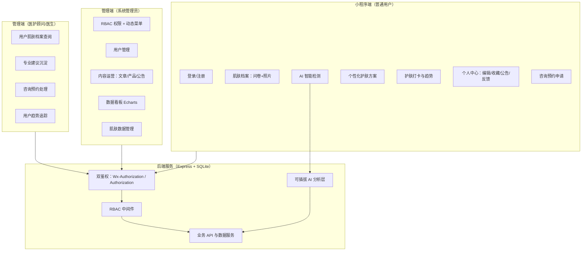

# 产品需求文档（PRD）：智能护肤小程序

> 项目名称：基于 AI 大模型 + 微信小程序的肌肤养护管理系统
> 项目代号：`skin_care_system`
> 文档版本：v1.0（MVP）
> 撰写人：许清楚（产品经理）
> 状态：待架构师评审

---

## 1. 项目信息

| 项 | 内容 |
|---|---|
| 项目名称 | 基于 AI 大模型 + 微信小程序的肌肤养护管理系统（智能护肤小程序） |
| 技术栈 | 后端：Node.js(Express) + SQLite（可迁移 MySQL/云数据库）；管理端：Vue3 + Vite + Element Plus；小程序端：uni-app(Vue3+Vite)，可编译微信小程序与 H5 |
| AI 能力 | 可插拔 AI 分析层：默认使用 DeepSeek（文本 `deepseek-chat` + 视觉 `deepseek-v4-flash-vision-exp`，OpenAI 兼容），本地色彩学启发式分析引擎（肤色/油干性/痤疮/平滑度评分）作为无 Key/离线兜底；预留统一 Provider 接口便于扩展其他模型 |
| 认证方案 | JWT 无状态 + RBAC 角色权限 + 动态菜单；后台用户/管理端用 `Authorization`，小程序用户用 `Wx-Authorization` 双鉴权隔离 |
| 交付范围 | MVP 核心闭环；暂不包含支付、短信等 |

原始需求复述：用户对自己的肤质认识不清，肌肤问题判断不准，也缺专业的护肤指导；市面上的平台功能比较单一，没有 AI 检测，也没有数据沉淀和专业的医护对接。要做的是普通用户智能护肤、医护顾问给专业意见、管理员高效运维，三端协同起来。

---

## 2. 产品定义

### 2.1 产品目标（3 个，彼此独立）

1. 测肤这条路要能走通，效果也得能量出来。用户得能走完「问卷建档 → 照片上传 → AI 检测 → 肤质/问题/风险/得分报告」这一整条，首次建档到出报告的转化率目标 ≥ 80%。
2. 方案和习惯得能留住人，同样用数字衡量。给出个性化每日护肤方案和「清洁/保湿/防晒」打卡，把肌肤趋势曲线画出来，MVP 期的次日留存目标 ≥ 40%。
3. 三端得协同起来，这一点同样能对照着验收。管理员靠 RBAC 和看板做运维，医护顾问在医生工作台查档案、写建议、处理咨询预约，三端共用同一套数据底座，数据对得上，不会各存一份。

### 2.2 目标用户画像

| 角色 | 画像 | 核心诉求 |
|---|---|---|
| 普通用户 | 20–35 岁，关注护肤但缺乏专业知识的年轻女性为主，日常使用微信 | 想知道自己是什么肤质、有什么肌肤问题、每天该怎么护肤、有没有变好 |
| 医护顾问/医生 | 皮肤科医生、医美/护肤顾问 | 快速查看用户完整肌肤档案、给出专业建议、线上处理咨询与预约、追踪用户肌肤变化 |
| 系统管理员 | 平台运营/后台维护人员 | 管控账号与权限、管理科普/产品/公告内容、看数据掌握运营情况、维护肌肤数据字典 |

---

## 3. 用户故事（每角色 ≥ 3 条）

### 普通用户（小程序端）

- **US-U1**：作为普通用户，我希望能用微信一键登录并完成四步肤质问卷，先把肌肤档案建起来。
- **US-U2**：作为普通用户，我希望上传脸部照片后系统自动识别我的肤质、问题与风险并打分，不用跑线下也能知道自己的皮肤状况。
- **US-U3**：作为普通用户，我希望得到一份包含每日流程、成分建议与禁忌的个性化护肤方案，每天照着做就行。
- **US-U4**：作为普通用户，我希望每天打卡「清洁/保湿/防晒」并看到趋势曲线，好让我坚持下去，也能看出有没有效果。
- **US-U5**：作为普通用户，我希望能收藏有用文章、查看公告、提交反馈并在个人中心编辑档案，以便持续获得服务和帮助。

### 医护顾问/医生（管理端·医生工作台）

- **US-D1**：作为医生，我希望按用户维度查阅其完整肌肤档案（问卷+照片+历次 AI 检测结果），诊断才能下得准。
- **US-D2**：作为医生，我希望对用户提交专业建议并沉淀为可复用模板，效率高一些，专业经验也留得下来。
- **US-D3**：作为医生，我希望处理用户的线上咨询预约，以便安排一对一的专业服务。
- **US-D4**：作为医生，我希望查看用户肌肤趋势追踪曲线，判断方案有没有效果，再决定要不要调整建议。

### 系统管理员（管理端）

- **US-A1**：作为管理员，我希望配置 RBAC 角色与权限并动态渲染菜单，让不同人员只看到自己有权操作的内容。
- **US-A2**：作为管理员，我希望对用户、医护顾问账号进行增删改查与状态管理，以便平台安全可控。
- **US-A3**：作为管理员，我希望管理科普文章/护肤产品/公告的内容 CRUD，持续输出运营内容。
- **US-A4**：作为管理员，我希望通过 Echarts 看板查看新增用户、活跃用户与肌肤问题分布，以便做运营决策。
- **US-A5**：作为管理员，我希望维护肌肤数据（肤质/问题/成分等字典），让系统检测和方案规则都能配置。

---

## 4. 需求池（P0/P1/P2）

> 说明：P0 = 必须首轮交付（MVP 的核心范围）；P1 = 应交付（增强体验）；P2 = 可交付（锦上添花）。

### 4.1 普通用户（小程序端）

| 编号 | 需求 | 说明 | 优先级 |
|---|---|---|---|
| U-01 | 微信登录/注册 | 微信授权登录，自动建档；无需手机号 | P0 |
| U-02 | 四步肤质问卷 | 肤质类型、敏感度、生活习惯、问题自评，参照「皮肤管家」 | P0 |
| U-03 | 肌肤档案 | 保存问卷结果 + 照片，可查看与编辑 | P0 |
| U-04 | 照片上传 | 本地/相册/拍摄上传，前端压缩后提交 | P0 |
| U-05 | AI 智能检测 | 图像特征→肤质识别→问题筛查→风险评级→肌肤得分→分析报告（六步） | P0 |
| U-06 | 个性化护肤方案 | 每日流程（早晚 Routine 结构化）、成分建议、禁忌 | P0 |
| U-07 | 护肤打卡 | 清洁/保湿/防晒打卡，当日完成状态 | P0 |
| U-08 | 趋势记录 | 水分/油脂/得分趋势曲线，参照 GlowSkin | P0 |
| U-09 | 个人中心 | 档案编辑、我的收藏、我的报告 | P0 |
| U-10 | 公告查看 | 首页/个人中心查看公告列表与详情 | P0 |
| U-11 | 反馈提交 | 提交文字反馈 | P1 |
| U-12 | 文章收藏 | 收藏/取消收藏科普文章 | P1 |
| U-13 | 咨询预约申请 | 提交线上咨询预约 | P1 |
| U-14 | 紫外线提示 | 基于位置/天气的防晒提醒，参照「皮肤管家」 | P2 |
| U-15 | 成分库检索 | 查询成分安全评价，参照 GlowSkin | P2 |

### 4.2 医护顾问/医生（管理端·医生工作台）

| 编号 | 需求 | 说明 | 优先级 |
|---|---|---|---|
| D-01 | 用户肌肤档案查阅 | 按用户查看问卷+照片+历次检测报告（只读+专业视图） | P0 |
| D-02 | 专业建议沉淀 | 对用户撰写建议，可存为模板复用 | P0 |
| D-03 | 咨询预约处理 | 查看/接受/完成线上咨询预约 | P1 |
| D-04 | 用户趋势追踪 | 查看用户得分/问题趋势曲线 | P1 |
| D-05 | 建议模板管理 | 维护常用建议模板库 | P2 |

### 4.3 系统管理员（管理端）

| 编号 | 需求 | 说明 | 优先级 |
|---|---|---|---|
| A-01 | RBAC 权限管控 + 动态菜单 | 角色/权限配置，前端按权限渲染菜单与按钮 | P0 |
| A-02 | 用户管理 | 普通用户与医护顾问账号 CRUD、状态启停 | P0 |
| A-03 | 内容运营（科普文章） | 文章 CRUD、发布/下架 | P0 |
| A-04 | 内容运营（产品） | 护肤产品 CRUD | P0 |
| A-05 | 公告管理 | 公告 CRUD | P0 |
| A-06 | 数据看板 | Echarts：新增用户、活跃用户、肌肤问题分布 | P0 |
| A-07 | 肌肤数据管理 | 肤质/问题/成分等字典维护 | P1 |
| A-08 | 反馈管理 | 查看/回复用户反馈 | P1 |
| A-09 | 检测记录管理 | 查看全量检测记录与 AI 引擎状态 | P1 |
| A-10 | 操作日志 | 关键操作审计日志 | P2 |

---

## 5. 功能结构图

---

## 6. 核心页面清单

### 6.1 小程序端（uni-app）

| 页面 | 路径（示意） | 核心功能 | 优先级 |
|---|---|---|---|
| 首页 | pages/home/index | 皮肤概览卡片、快捷入口（测肤/打卡/方案）、公告轮播、紫外线提示 | P0 |
| 登录页 | pages/login/index | 微信授权登录 | P0 |
| 肤质问卷 | pages/survey/index | 四步问卷 | P0 |
| 肌肤档案 | pages/profile/skin | 档案展示与编辑 | P0 |
| 照片上传 | pages/detect/upload | 拍照/相册上传、预览 | P0 |
| 检测结果 | pages/detect/result | 肤质/问题/风险/得分/报告 | P0 |
| 护肤方案 | pages/plan/index | 早晚 Routine、成分建议、禁忌 | P0 |
| 打卡页 | pages/checkin/index | 清洁/保湿/防晒打卡 | P0 |
| 趋势页 | pages/trend/index | 得分/水分/油脂趋势曲线 | P0 |
| 个人中心 | pages/mine/index | 档案/收藏/公告/反馈入口 | P0 |
| 文章列表/详情 | pages/article/list、detail | 科普文章浏览、收藏 | P1 |
| 咨询预约 | pages/consult/index | 提交预约 | P1 |

### 6.2 管理端（Vue3 + Element Plus）

| 模块 | 路由（示意） | 核心功能 | 优先级 |
|---|---|---|---|
| 登录页 | /login | 后台账号密码登录 | P0 |
| 工作台首页 | /dashboard | 数据看板 Echarts（新增/活跃/问题分布） | P0 |
| 用户管理 | /users | 用户 CRUD、状态 | P0 |
| 角色权限 | /rbac | 角色/权限配置、动态菜单 | P0 |
| 文章管理 | /content/article | 文章 CRUD | P0 |
| 产品管理 | /content/product | 产品 CRUD | P0 |
| 公告管理 | /content/notice | 公告 CRUD | P0 |
| 肌肤数据 | /skin-dict | 肤质/问题/成分字典 | P1 |
| 反馈管理 | /feedback | 反馈查看/回复 | P1 |
| 检测记录 | /detect-records | 全量检测记录 | P1 |

### 6.3 医生工作台（管理端内角色视图）

| 模块 | 路由（示意） | 核心功能 | 优先级 |
|---|---|---|---|
| 医生工作台 | /doctor | 待处理咨询/最近查看用户 | P1 |
| 用户档案 | /doctor/patients/:id | 完整档案 + 历次报告 + 趋势 | P0 |
| 建议撰写 | /doctor/patients/:id/advice | 建议撰写与模板沉淀 | P0 |
| 咨询预约 | /doctor/consultations | 预约列表与处理 | P1 |

---

## 7. 核心 API 清单（Restful）

> 前缀约定：小程序端 `/api/wx/*`（Header: `Wx-Authorization`）；管理端/医生端 `/api/admin/*`（Header: `Authorization`）。

### 7.1 认证与用户

| 方法 | 路径 | 说明 |
|---|---|---|
| POST | /api/wx/auth/login | 微信登录（code 换 openid，签发 JWT） |
| GET | /api/wx/users/me | 获取当前用户信息 |
| PUT | /api/wx/users/me | 更新个人资料 |
| POST | /api/admin/auth/login | 后台账号登录（账号+密码） |
| POST | /api/admin/auth/refresh | 刷新 token |
| GET | /api/admin/users/me | 当前后台用户信息与菜单 |
| GET | /api/admin/users | 用户列表（分页/筛选） |
| POST | /api/admin/users | 新增用户/顾问 |
| PUT | /api/admin/users/:id | 编辑用户 |
| PATCH | /api/admin/users/:id/status | 启停用户 |

### 7.2 肌肤档案与检测

| 方法 | 路径 | 说明 |
|---|---|---|
| POST | /api/wx/skin-profile/survey | 提交肤质问卷 |
| GET | /api/wx/skin-profile | 获取我的肌肤档案 |
| PUT | /api/wx/skin-profile | 编辑档案 |
| POST | /api/wx/detect/upload | 上传照片（返回临时 fileId） |
| POST | /api/wx/detect/analyze | 发起 AI 检测（含照片，返回报告） |
| GET | /api/wx/detect/:id | 获取检测报告详情 |
| GET | /api/wx/detect | 我的检测记录列表 |
| GET | /api/admin/detect-records | 全量检测记录（管理员） |

### 7.3 护肤方案与打卡

| 方法 | 路径 | 说明 |
|---|---|---|
| GET | /api/wx/plan | 获取个性化护肤方案 |
| GET | /api/wx/checkin/today | 获取今日打卡状态 |
| POST | /api/wx/checkin | 提交打卡（cleanse/moisturize/sunscreen） |
| GET | /api/wx/trend | 获取趋势数据（得分/水分/油脂） |

### 7.4 内容与运营

| 方法 | 路径 | 说明 |
|---|---|---|
| GET | /api/wx/articles | 文章列表（公开） |
| GET | /api/wx/articles/:id | 文章详情 |
| POST | /api/wx/favorites | 收藏/取消收藏 |
| GET | /api/wx/notices | 公告列表 |
| POST | /api/wx/feedback | 提交反馈 |
| POST | /api/admin/articles | 新增文章 |
| PUT | /api/admin/articles/:id | 编辑文章 |
| DELETE | /api/admin/articles/:id | 删除文章 |
| POST | /api/admin/products | 新增产品 |
| PUT | /api/admin/products/:id | 编辑产品 |
| DELETE | /api/admin/products/:id | 删除产品 |
| POST | /api/admin/notices | 新增公告 |
| PUT | /api/admin/notices/:id | 编辑公告 |
| DELETE | /api/admin/notices/:id | 删除公告 |

### 7.5 医生工作台与咨询

| 方法 | 路径 | 说明 |
|---|---|---|
| GET | /api/admin/patients | 用户档案列表（医生视图） |
| GET | /api/admin/patients/:id | 用户完整档案 + 历次报告 |
| GET | /api/admin/patients/:id/trend | 用户趋势数据 |
| POST | /api/admin/patients/:id/advice | 撰写专业建议 |
| GET | /api/admin/advice-templates | 建议模板列表 |
| POST | /api/admin/consultations | 用户发起预约（小程序侧 POST /api/wx/consultations） |
| GET | /api/admin/consultations | 预约列表 |
| PATCH | /api/admin/consultations/:id | 处理预约（接受/完成/取消） |

### 7.6 RBAC 与看板

| 方法 | 路径 | 说明 |
|---|---|---|
| GET | /api/admin/roles | 角色列表 |
| POST | /api/admin/roles | 新增角色 |
| PUT | /api/admin/roles/:id | 编辑角色权限 |
| GET | /api/admin/dashboard/summary | 看板汇总（新增/活跃/问题分布） |
| GET | /api/admin/skin-dict | 肌肤数据字典列表 |
| POST | /api/admin/skin-dict | 新增字典项 |
| PUT | /api/admin/skin-dict/:id | 编辑字典项 |

---

## 8. 待确认问题清单（含建议默认值）

| # | 问题 | 建议默认值 |
|---|---|---|
| 1 | 微信登录是否需绑定手机号？涉及实名与召回能力 | MVP 仅用 openid 免手机号登录，后续如需再补手机号绑定 |
| 2 | AI 检测的图片如何存储？本地磁盘还是对象存储 | MVP 存本地 `uploads/` 目录，路径入库；预留云存储配置项 |
| 3 | 本地色彩学启发式引擎的评分维度与阈值如何定义 | 采用 SkinAI 四维（肤色/油干性/痤疮/平滑度），每维 0–100 分，综合得分加权；阈值先用经验值，后续可后台字典调参 |
| 4 | 肌肤得分与风险评级的映射规则 | 综合分 ≥80 良好、60–79 一般、40–59 需关注、<40 高风险（四档），先硬编码、后接字典 |
| 5 | 打卡频次是否允许补卡？趋势数据采样口径 | 允许当天内补卡；趋势按「每日最新一条」采样 |
| 6 | 医生「专业建议」是否需要用户在小程序端可见并回复 | MVP 医生建议仅医生端沉淀、用户在报告页只读可见，不做双向 IM |
| 7 | 管理端是否需独立的「医生」角色初始账号 | 提供种子数据：admin（管理员）、doctor（医生）各一个默认账号，密码初始化后强制修改 |
| 8 | 数据看板统计口径（活跃用户定义） | 活跃用户 = 近 7 日有登录或打卡/检测行为的去重用户数 |
| 9 | 内容（文章/产品/公告）是否支持富文本与图片 | 文章/产品支持富文本（含图），公告仅纯文本 + 标题 |
| 10 | SQLite 是否需要数据迁移/备份脚本 | 提供初始化建表脚本与 JSON 导出备份接口，迁移 MySQL 保留兼容方言 |

---

## 9. 验收口径（可度量）

- 用户能走完「问卷→照片→检测→报告」整条链路，无阻断报错。
- 三角色登录后可见各自权限内的页面与数据，越权访问返回 403。
- 管理端能完成用户/文章/产品/公告的增删改查，看板能展示三类图表。
- 医生能查阅至少 1 名用户完整档案并成功提交一条专业建议。
- 打卡与趋势数据在次日能正确累计并绘制曲线。

---

*本文档为 MVP 范围基线，架构师可据此进行模块划分与任务分解。*
