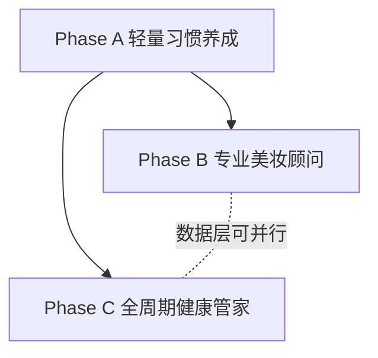
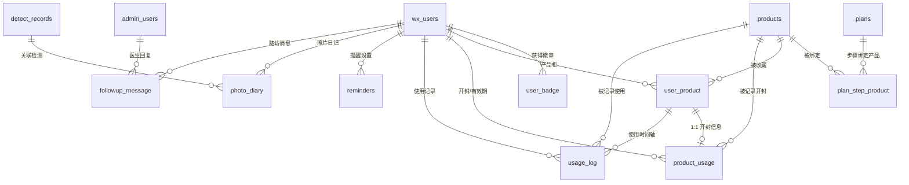
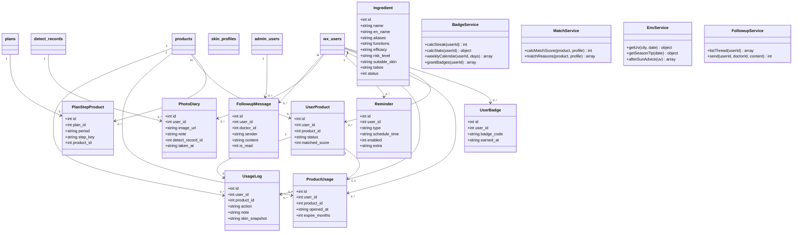
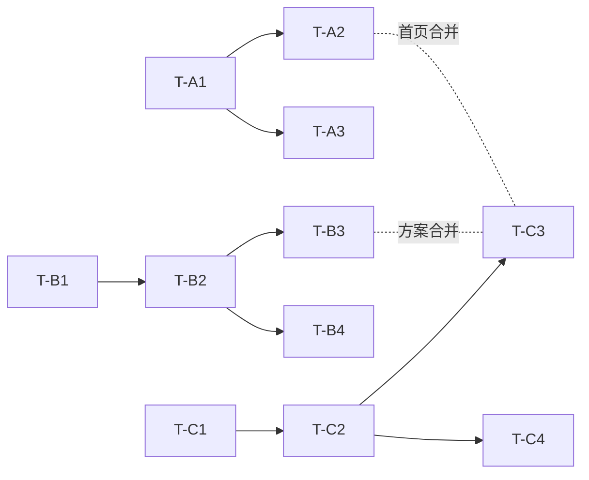

# 四大 tab 丰富性增量设计（组合路线 A→B→C）

> 项目：基于 AI 大模型 + 微信小程序的肌肤养护管理系统（智能护肤小程序）
> 文档类型：增量架构设计 + 任务分解（在 v1.0 基线上叠加）
> 撰写：高见远（架构师）
> 上游依据：`docs/四大tab丰富方案.md`（方案 A/B/C + §7 横向对比 + §8 选型建议）、`docs/ARCHITECTURE.md`（v1.0 基线）
> 基线状态：`docs/ARCHITECTURE.md` §7 的 T1–T10 已实现，19 张表、双鉴权、AI 可插拔层、四 tab 页面均已就绪。

---

## 1. 增量总览

### 1.1 三阶段范围

| 阶段 | 一句话定位 | 核心增量 | 新增表 | 主要依赖 |
|---|---|---|---|---|
| **Phase A 轻量习惯养成** | 把「坚持护肤」变成有反馈的日常 | 连续打卡 streak、徽章成就、今日待办、周历、方案内嵌打卡、累计统计 | 1 张（`user_badge`） | 复用 `checkin_records` / `plans`，**零外部依赖** |
| **Phase B 专业美妆顾问** | 让方案落地到「具体产品与成分」 | 成分库、方案—产品关联、开封有效期、肤质匹配、产品柜、使用时间轴 | 5 张（`ingredients` / `plan_step_product` / `user_product` / `product_usage` / `usage_log`） | 复用 `products` / `plans` / `skin_profiles`，需成分/产品数据建设 |
| **Phase C 全周期健康管家** | 像管家一样提醒「今天该做什么」 | UV/天气提醒、季节护理、复测提醒、照片对比日记、报告时间轴、医生轻随访 | 3 张（`reminders` / `photo_diary` / `followup_message`） | 复用 `detect_records` / `plans` / `checkin_records`，天气走规则降级不阻塞 |

### 1.2 依赖关系与可并行性



- A 完全独立。streak、周历、待办、徽章都由既有的 `checkin_records` 和 `plans` 算出来，只新增 1 张表，最快 1 周能上线。
- B 要用现有的 `products` / `plans` / `skin_profiles`，和 A 没有强耦合，数据层可以同时开工。麻烦在方案 tab：两边前端有重叠，建议 A 合入之后再动 B 的方案页。
- C 要用 A 的打卡/待办和 B 的方案/产品。UV、季节、复测这三块本质是「读数据 + 跑规则」，照片日记和随访各建各的表，数据层同样能和 A/B 并行。首页也是同一个问题，A 的待办卡和 B 的成分入口挤在一页上，所以合并顺序还是按 A → B → C，免得首页 tab 反复冲突。
- 落地顺序：A 先做，用来验证留存；B 是核心，专业不专业主要看它；C 收尾，补上长期陪伴的感觉。B/C 的后端数据层可以并行，前端按这个顺序交付。

---

## 2. 增量数据表设计

> 全部遵循 v1.0 全局约定：主键 `id INTEGER PRIMARY KEY AUTOINCREMENT`；时间戳 `TEXT` ISO 8601 UTC；`created_at/updated_at` 必备；核心业务表加 `deleted_at` 软删除；JSON 以 `TEXT` 存字符串；外键列/高频筛选列建索引。

### 2.1 新增表清单（9 张）

#### Phase A（1 张）

**⑳ user_badge（用户徽章）**
| 字段 | 类型 | 约束/说明 |
|---|---|---|
| id | INTEGER | PK |
| user_id | INTEGER | NOT NULL，FK → `wx_users.id`（用户获得徽章） |
| badge_code | TEXT | NOT NULL，徽章编码（见 §6.3 规则常量） |
| earned_at | TEXT | 获得时间 |
| created_at | TEXT | — |

- 索引：`UNIQUE(user_id, badge_code)`（幂等发放）、`idx_user_badge_user(user_id)`。
- 关联：`user_badge` N:1 `wx_users`。徽章规则本身是常量，不建表。

#### Phase B（5 张）

**㉑ ingredients（成分库）**
| 字段 | 类型 | 约束/说明 |
|---|---|---|
| id | INTEGER | PK |
| name | TEXT | NOT NULL UNIQUE，中文名 |
| en_name | TEXT | 英文名/INCI |
| aliases | TEXT | JSON 数组（别名） |
| functions | TEXT | JSON 数组（功能标签：保湿/控油/提亮/抗老/修护/防晒…） |
| efficacy | TEXT | 功效说明 |
| risk_level | TEXT | 低/中/高 |
| suitable_skin | TEXT | JSON 数组（适用肤质） |
| taboo | TEXT | 禁忌/注意事项 |
| description | TEXT | 白话解读 |
| status | INTEGER | 1 启用 / 0 停用，默认 1 |
| created_at / updated_at / deleted_at | TEXT | — |

- 索引：`UNIQUE(name)`、`idx_ingredient_status(status)`。
- 关联：独立主数据表；被 `products.ingredients`（JSON 名称）与方案成分建议引用（按 name 关联，详见 §2.2）。

**㉒ plan_step_product（方案步骤—产品关联）**
| 字段 | 类型 | 约束/说明 |
|---|---|---|
| id | INTEGER | PK |
| plan_id | INTEGER | NOT NULL，FK → `plans.id` |
| period | TEXT | NOT NULL，`morning` / `evening` |
| step_key | TEXT | NOT NULL，步骤键（`cleanse`/`toner`/`serum`/`moisturize`/`sunscreen`/`repair`，与 `planGenerator.STEP_TEMPLATES` 一致） |
| product_id | INTEGER | NOT NULL，FK → `products.id` |
| created_at / updated_at | TEXT | — |

- 索引：`UNIQUE(plan_id, period, step_key)`、`idx_psp_product(product_id)`。
- 关联：`plan_step_product` N:1 `plans`、N:1 `products`。

**㉓ user_product（我的产品柜）**
| 字段 | 类型 | 约束/说明 |
|---|---|---|
| id | INTEGER | PK |
| user_id | INTEGER | NOT NULL，FK → `wx_users.id` |
| product_id | INTEGER | NOT NULL，FK → `products.id` |
| status | TEXT | `using`/`stopped`/`wish`，默认 `using` |
| matched_score | INTEGER | 肤质匹配度 0–100（计算缓存，可空） |
| added_at | TEXT | 加入时间 |
| created_at / updated_at | TEXT | — |

- 索引：`UNIQUE(user_id, product_id)`、`idx_user_product_user(user_id)`、`idx_user_product_product(product_id)`。
- 关联：`user_product` N:1 `wx_users`、N:1 `products`。

**㉔ product_usage（产品开封/有效期）**
| 字段 | 类型 | 约束/说明 |
|---|---|---|
| id | INTEGER | PK |
| user_id | INTEGER | NOT NULL，FK → `wx_users.id` |
| product_id | INTEGER | NOT NULL，FK → `products.id` |
| opened_at | TEXT | 开封日期 `YYYY-MM-DD` |
| expire_months | INTEGER | 开封后有效月数，默认 12 |
| note | TEXT | 备注 |
| created_at / updated_at | TEXT | — |

- 索引：`UNIQUE(user_id, product_id)`、`idx_product_usage_user(user_id)`。
- 关联：`product_usage` N:1 `wx_users`、N:1 `products`；与 `user_product` 逻辑上 1:1（同一用户同一产品一条开封记录）。

**㉕ usage_log（使用记录时间轴）**
| 字段 | 类型 | 约束/说明 |
|---|---|---|
| id | INTEGER | PK |
| user_id | INTEGER | NOT NULL，FK → `wx_users.id` |
| product_id | INTEGER | NOT NULL，FK → `products.id` |
| action | TEXT | NOT NULL，`start` / `stop` / `note` |
| note | TEXT | 说明（如「停用后爆痘减少」） |
| skin_snapshot | TEXT | JSON 可选（当时肤况快照 `{score, skinType}`） |
| created_at | TEXT | — |

- 索引：`idx_usage_log_user_created(user_id, created_at)`、`idx_usage_log_product(product_id)`。
- 关联：`usage_log` N:1 `wx_users`、N:1 `products`。

#### Phase C（3 张）

**㉖ reminders（提醒设置）**
| 字段 | 类型 | 约束/说明 |
|---|---|---|
| id | INTEGER | PK |
| user_id | INTEGER | NOT NULL，FK → `wx_users.id` |
| type | TEXT | NOT NULL，`morning`/`evening`/`uv_reapply`/`recheck`/`season` |
| schedule_time | TEXT | 触发时间 `HH:mm`（季节/UV 类可空） |
| enabled | INTEGER | 1 启用 / 0 关闭，默认 1 |
| extra | TEXT | JSON（如 `{city:"北京", uvThreshold:6}`） |
| created_at / updated_at | TEXT | — |

- 索引：`idx_reminder_user_type(user_id, type)`。
- 关联：`reminders` N:1 `wx_users`。

**㉗ photo_diary（肤质照片对比日记）**
| 字段 | 类型 | 约束/说明 |
|---|---|---|
| id | INTEGER | PK |
| user_id | INTEGER | NOT NULL，FK → `wx_users.id` |
| image_url | TEXT | NOT NULL，相对路径 `/uploads/...` |
| note | TEXT | 备注 |
| detect_record_id | INTEGER | 可空，FK → `detect_records.id`（关联某次检测） |
| taken_at | TEXT | 拍摄日期 `YYYY-MM-DD` |
| created_at | TEXT | — |

- 索引：`idx_photo_diary_user_taken(user_id, taken_at)`。
- 关联：`photo_diary` N:1 `wx_users`、N:0..1 `detect_records`。

**㉘ followup_message（医生轻随访）**
| 字段 | 类型 | 约束/说明 |
|---|---|---|
| id | INTEGER | PK |
| user_id | INTEGER | NOT NULL，FK → `wx_users.id` |
| doctor_id | INTEGER | 可空，FK → `admin_users.id` |
| sender | TEXT | NOT NULL，`user` / `doctor` |
| content | TEXT | NOT NULL |
| is_read | INTEGER | 0 未读 / 1 已读，默认 0 |
| created_at | TEXT | — |

- 索引：`idx_followup_user_created(user_id, created_at)`、`idx_followup_user_read(user_id, is_read)`。
- 关联：`followup_message` N:1 `wx_users`、N:0..1 `admin_users`。

### 2.2 复用现有表（无需新表）

| 功能 | 复用依据 | 说明 |
|---|---|---|
| 连续打卡 streak / 累计 / 最长连续 / 完成率 | `checkin_records` | 按 `checkin_date` 排序计算，无需新表 |
| 7 日周历视图 | `checkin_records` | 按日期区间取 7 天记录 |
| 今日待办聚合 | `checkin_records` + `plans` | 打卡三项 + 方案步骤完成度 |
| 方案内嵌打卡 | `checkin_records` | 方案步骤映射到打卡三项（详见 §8#1） |
| 肤质匹配度评分 | `skin_profiles` + `products.ingredients` | 规则引擎计算，可缓存到 `user_product.matched_score` |
| 复测提醒 | `detect_records` | 取 `latestByUser.created_at` 距今天数 |
| 报告历史时间轴 | `detect_records` + `advice` | 按时间轴聚合检测报告与医生建议 |
| 季节护理 / 晒后护理 / UV 降级 | 规则常量 | 见 §6，无表 |
| 城市字典（可选） | `skin_dict`（`dict_type='city'`） | 供 UV 规则降级选择城市 |

### 2.3 E-R 关系图（增量部分）



### 2.4 类图（数据结构 + 服务）



---

## 3. 增量 API 设计

> 统一响应 `{code, msg, data}`（`code=0` 成功）；鉴权前缀 `/api/wx/*`（`Wx-Authorization`）与 `/api/admin/*`（`Authorization` + RBAC）。「类型」标注为「纯计算」或「需新表」。

### 3.1 API 总表

#### Phase A

| 方法 | 路径 | 鉴权 | 说明 | 类型 |
|---|---|---|---|---|
| GET | `/api/wx/checkin/stats` | Wx | 累计统计 + streak + 本周完成率 | 纯计算（`checkin_records`） |
| GET | `/api/wx/checkin/calendar?days=7` | Wx | 7 日周历视图 | 纯计算（`checkin_records`） |
| GET | `/api/wx/badges` | Wx | 徽章墙（已获 + 未解锁 + 进度） | 需新表（`user_badge`） |
| GET | `/api/wx/home/summary` | Wx | 首页聚合（今日待办 + streak + 本周环） | 纯计算（`checkin_records`/`plans`/`detect_records`） |
| GET | `/api/wx/plan`（扩展） | Wx | 方案详情追加 `todayCheckin` + `stepProgress` | 纯计算（`plans`+`checkin_records`） |
| POST | `/api/wx/checkin`（复用） | Wx | 打卡；提交后触发徽章自动发放 | 复用 + 自动写 `user_badge` |

#### Phase B

| 方法 | 路径 | 鉴权 | 说明 | 类型 |
|---|---|---|---|---|
| GET | `/api/wx/ingredients?keyword=&page=` | Wx | 成分库检索 | 需新表（`ingredients`） |
| GET | `/api/wx/ingredients/:id` | Wx | 成分详情 | 需新表（`ingredients`） |
| GET | `/api/wx/products?keyword=&category=` | Wx | 产品列表（含肤质匹配度） | 需新表 + 计算 |
| GET | `/api/wx/products/:id` | Wx | 产品详情（成分详情 + 匹配度） | 需新表 + 计算 |
| GET | `/api/wx/plan/steps` | Wx | 方案步骤 + 已绑定产品 | 需新表（`plan_step_product`） |
| PUT | `/api/wx/plan/steps/:period/:stepKey/product` | Wx | 绑定/解绑步骤产品（body 可空=解绑） | 需新表（`plan_step_product`） |
| GET | `/api/wx/my-products` | Wx | 我的产品柜 | 需新表（`user_product`） |
| POST | `/api/wx/my-products` | Wx | 添加/更新产品柜（含状态） | 需新表（`user_product`） |
| DELETE | `/api/wx/my-products/:id` | Wx | 移除产品 | 需新表（`user_product`） |
| GET | `/api/wx/product-usages` | Wx | 开封/有效期列表（含剩余天数） | 需新表（`product_usage`） |
| POST | `/api/wx/product-usages` | Wx | 设置开封日期/周期 | 需新表（`product_usage`） |
| GET | `/api/wx/product-usages/expiring` | Wx | 即将到期/已到期列表 | 需新表（`product_usage`） |
| GET | `/api/wx/usage-logs?productId=` | Wx | 使用记录时间轴 | 需新表（`usage_log`） |
| POST | `/api/wx/usage-logs` | Wx | 记录使用事件（`start`/`stop`/`note`） | 需新表（`usage_log`） |
| GET/POST/PUT/DELETE | `/api/admin/ingredients` | Admin | 成分库维护 CRUD | 需新表（`ingredients`） |

#### Phase C

| 方法 | 路径 | 鉴权 | 说明 | 类型 |
|---|---|---|---|---|
| GET | `/api/wx/env/uv?city=` | Wx | UV/天气提醒卡（含防晒 + 晒后建议） | 规则/降级（无新表） |
| GET | `/api/wx/env/season-tip` | Wx | 季节护理提示 | 规则（无新表） |
| GET | `/api/wx/recheck` | Wx | 复测提醒（距上次检测天数） | 纯计算（`detect_records`） |
| GET | `/api/wx/reminders` | Wx | 我的提醒列表 | 需新表（`reminders`） |
| POST | `/api/wx/reminders` | Wx | 创建/更新提醒（按 type upsert） | 需新表（`reminders`） |
| PUT/DELETE | `/api/wx/reminders/:id` | Wx | 更新/删除提醒 | 需新表（`reminders`） |
| GET | `/api/wx/photo-diary` | Wx | 照片日记列表 | 需新表（`photo_diary`） |
| POST | `/api/wx/photo-diary` | Wx | 上传照片日记（multipart + note） | 需新表（`photo_diary`） |
| DELETE | `/api/wx/photo-diary/:id` | Wx | 删除照片日记 | 需新表（`photo_diary`） |
| GET | `/api/wx/reports` | Wx | 报告历史时间轴（检测 + 建议聚合） | 纯计算（`detect_records`/`advice`） |
| GET | `/api/wx/followup` | Wx | 我的随访消息列表 | 需新表（`followup_message`） |
| POST | `/api/wx/followup` | Wx | 用户发随访消息 | 需新表（`followup_message`） |
| GET | `/api/admin/followup` | Admin | 医生侧随访用户/消息列表 | 需新表（`followup_message`） |
| POST | `/api/admin/followup/:userId/reply` | Admin | 医生回复 | 需新表（`followup_message`） |

### 3.2 关键接口 JSON 示例

#### A-1 打卡统计 `GET /api/wx/checkin/stats`
```json
{
  "code": 0, "msg": "success",
  "data": {
    "streak": 5,
    "totalDays": 12,
    "longestStreak": 7,
    "weekRate": 0.71,
    "weekDone": 5,
    "todayDone": 2,
    "todayTotal": 3
  }
}
```

#### A-2 周历 `GET /api/wx/checkin/calendar?days=7`
```json
{
  "code": 0, "msg": "success",
  "data": [
    { "date": "2026-10-19", "cleanse": 1, "moisturize": 1, "sunscreen": 1, "isToday": false },
    { "date": "2026-10-20", "cleanse": 1, "moisturize": 0, "sunscreen": 1, "isToday": false },
    { "date": "2026-10-21", "cleanse": 1, "moisturize": 1, "sunscreen": 0, "isToday": true }
  ]
}
```

#### A-3 徽章墙 `GET /api/wx/badges`
```json
{
  "code": 0, "msg": "success",
  "data": [
    { "code": "first_day", "name": "初来乍到", "desc": "完成第一次打卡", "icon": "🌱", "earned": true,  "earnedAt": "2026-10-15T08:00:00.000Z", "progress": "1/1" },
    { "code": "streak_7", "name": "七日坚持", "desc": "连续打卡7天", "icon": "🔥", "earned": false, "earnedAt": null, "progress": "5/7" }
  ]
}
```

#### A-4 首页聚合 `GET /api/wx/home/summary`
```json
{
  "code": 0, "msg": "success",
  "data": {
    "streak": 5,
    "weekRate": 0.71,
    "latestScore": 78,
    "todayTodo": [
      { "key": "sunscreen", "label": "防晒", "done": false, "url": "/pages/checkin/index" },
      { "key": "planStep", "label": "晚间保湿", "done": false, "url": "/pages/plan/index" }
    ]
  }
}
```

#### B-1 成分详情 `GET /api/wx/ingredients/:id`
```json
{
  "code": 0, "msg": "success",
  "data": {
    "id": 1, "name": "烟酰胺", "enName": "Niacinamide", "aliases": ["维生素B3"],
    "functions": ["控油", "提亮", "修护屏障"],
    "efficacy": "改善毛孔粗大与暗沉，控油提亮",
    "riskLevel": "低", "suitableSkin": ["油性", "混合性"],
    "taboo": "部分人群需建立耐受，避免与高浓度酸叠加", "description": "烟酰胺是维生素B3衍生物……"
  }
}
```

#### B-2 产品详情（含匹配度）`GET /api/wx/products/:id`
```json
{
  "code": 0, "msg": "success",
  "data": {
    "id": 3, "name": "烟酰胺控油精华", "brand": "示例品牌", "category": "精华",
    "matchScore": 88,
    "matchReasons": ["含烟酰胺，适配油性肤质", "含透明质酸，补水保湿"],
    "ingredients": [
      { "ingredientId": 1, "name": "烟酰胺", "riskLevel": "低", "efficacy": "控油提亮" }
    ]
  }
}
```

#### B-3 添加产品柜 `POST /api/wx/my-products`
```json
// 请求
{ "productId": 3, "status": "using" }
// 响应
{ "code": 0, "msg": "success", "data": { "id": 9, "productId": 3, "status": "using", "matchedScore": 88 } }
```

#### B-4 设置开封有效期 `POST /api/wx/product-usages`
```json
// 请求
{ "productId": 3, "openedAt": "2026-09-01", "expireMonths": 12 }
// 响应
{ "code": 0, "msg": "success", "data": { "id": 4, "expireAt": "2027-09-01", "daysLeft": 320, "expired": false } }
```

#### C-1 UV/天气提醒卡 `GET /api/wx/env/uv?city=北京`
```json
{
  "code": 0, "msg": "success",
  "data": {
    "city": "北京", "uvIndex": 7, "uvLevel": "高", "source": "rule",
    "sunscreenAdvice": "SPF50+ PA+++，每2小时补涂",
    "afterSunAdvice": ["冷敷舒缓", "涂抹含积雪草/泛醇的修护产品", "多补水"],
    "seasonTip": "夏季：控油防晒、晒后修护"
  }
}
```

#### C-2 上传照片日记 `POST /api/wx/photo-diary`（multipart：file + note）
```json
{ "code": 0, "msg": "success", "data": { "id": 3, "imageUrl": "/uploads/diary_xxx.jpg", "note": "晨起状态", "takenAt": "2026-10-21" } }
```

#### C-3 用户发随访消息 `POST /api/wx/followup`
```json
// 请求
{ "content": "最近脸颊有点泛红，需要调整方案吗？" }
// 响应
{ "code": 0, "msg": "success", "data": { "id": 6, "sender": "user", "content": "最近脸颊有点泛红，需要调整方案吗？", "createdAt": "2026-10-21T10:00:00.000Z" } }
```

#### C-4 医生回复 `POST /api/admin/followup/:userId/reply`
```json
// 请求
{ "content": "建议暂停使用视黄醇，加强保湿修护，可预约复测。" }
// 响应
{ "code": 0, "msg": "success", "data": { "id": 7, "sender": "doctor" } }
```

---

## 4. 前端改动点

> 四个 tab 页面为 `home` / `checkin` / `plan` / `mine`；跳转统一走 `utils/nav.ts` 的 `goPage`（tabBar 用 `switchTab`）。新增页面需同步注册进 `pages.json`。

### 4.1 首页 `miniapp/src/pages/home/index.vue`

| Phase | UI 结构新增 | 交互 | 涉及文件 |
|---|---|---|---|
| A | hero 卡顶部「🔥 已连续 N 天」；新增「今日待办」卡片（聚合打卡三项 + 方案步骤未完成项）；「本周完成率环」进度环 | 待办项点击直达对应 tab；环由 `home/summary` 驱动 | `home/index.vue`、`components/ProgressRing.vue`（新）、`api/home.ts`（新） |
| B | 快捷入口新增「成分速查」；新增「肤质匹配推荐」卡片（按匹配度推荐产品） | 入口跳 `ingredient/list`；推荐卡跳 `product/detail` | `home/index.vue`、`api/product.ts` |
| C | 新增「UV/天气提醒卡」「季节护理提示」「复测提醒卡」（距上次检测 N 天） | UV 卡读 `env/uv`；复测卡跳 `detect/upload` | `home/index.vue`、`api/env.ts` |

### 4.2 打卡 `miniapp/src/pages/checkin/index.vue`

| Phase | UI 结构新增 | 交互 | 涉及文件 |
|---|---|---|---|
| A | 顶部 streak 火焰 + 情境激励文案；「7 日周历视图」圆点（勾=完成/点=漏签） | 打卡后周历/火焰即时刷新；文案随 streak 变化 | `checkin/index.vue`、`api/checkin.ts` |
| B | 「今日用了哪支产品」多选（关联产品柜） | 打卡时写入 `usage_log`（action=note 或快照） | `checkin/index.vue`、`api/product.ts` |
| C | 「防晒补涂提醒」设置入口 | 弹层设置 `reminders`（uv_reapply） | `checkin/index.vue`、`api/reminder.ts`、`components/ReminderSheet.vue`（新） |

### 4.3 方案 `miniapp/src/pages/plan/index.vue`

| Phase | UI 结构新增 | 交互 | 涉及文件 |
|---|---|---|---|
| A | 每步旁「✅ 已完成」勾选；顶部「今日方案完成 N/M 步」进度条 | 勾选与打卡三项联动（映射规则见 §8#1） | `plan/index.vue`、`api/plan.ts` |
| B | 每步显示「已绑定产品」标签 + 绑定按钮；成分建议名可点击 | 绑定跳产品选择；成分名跳 `ingredient/detail` | `plan/index.vue`、`api/plan.ts`、`api/product.ts` |
| C | 早晚差异提示（按时间段高亮早/晚 Routine）；UV 高时追加「晒后护理建议」 | 读 `env/uv` + 本地时间 | `plan/index.vue`、`api/env.ts` |

### 4.4 我的 `miniapp/src/pages/mine/index.vue`

| Phase | UI 结构新增 | 交互 | 涉及文件 |
|---|---|---|---|
| A | 「累计统计」卡片（累计/最长连续/完成率）；「徽章墙」入口 | 入口跳 `badges/index` | `mine/index.vue`、`api/badge.ts` |
| B | 「我的产品柜」「使用记录时间轴」入口 | 跳 `product/cabinet`、`product/usage` | `mine/index.vue` |
| C | 「肤质照片日记」「报告历史时间轴」「医生轻随访」入口 | 跳 `diary/index`、`report/timeline`、`followup/index` | `mine/index.vue` |

### 4.5 新增页面清单（需注册 `pages.json`）

| 页面 | 归属 | 说明 |
|---|---|---|
| `pages/badges/index.vue` | A | 徽章墙 |
| `pages/ingredient/list.vue` / `detail.vue` | B | 成分检索 / 详情 |
| `pages/product/list.vue` / `detail.vue` | B | 产品库（含匹配度）/ 详情 |
| `pages/product/cabinet.vue` | B | 我的产品柜 |
| `pages/product/usage.vue` | B | 使用记录时间轴 + 开封/有效期 |
| `pages/diary/index.vue` / `compare.vue` | C | 照片日记 / before-after 对比 |
| `pages/report/timeline.vue` | C | 报告历史时间轴 |
| `pages/followup/index.vue` | C | 医生轻随访会话 |

新增 API 模块：`miniapp/src/api/badge.ts`、`home.ts`、`ingredient.ts`、`product.ts`、`env.ts`、`reminder.ts`、`diary.ts`、`followup.ts`（均复用 `request.ts`）。

---

## 5. 分阶段任务列表

> 每个任务至少涉及 3 个相关文件，内部按「数据层 → 接口层 → 页面层」的顺序来写。每段末尾有一条「可独立验证边界」，用来说明这段做到哪儿就算完。

### Phase A：轻量习惯养成

#### T-A1 — 后端：徽章表 + 统计/徽章服务 + 接口
- **涉及文件**：`server/src/db/schema.sql`（新增 `user_badge`）、`server/src/repositories/userBadgeRepo.js`（新）、`server/src/config/skincareRules.js`（新，徽章规则常量）、`server/src/services/badgeService.js`（新，streak/stats/calendar/grant）、`server/src/controllers/wx/checkinController.js`（扩展 stats/calendar）、`server/src/controllers/wx/badgeController.js`（新）、`server/src/controllers/wx/homeController.js`（新，home/summary）、`server/src/controllers/wx/planController.js`（扩展 stepProgress）、`server/src/routes/wxRoutes.js`（挂载）
- **依赖**：无（基于既有 T1–T5）
- **验收标准**：
  - [ ] `schema.sql` 新增 `user_badge`，重启自动建表。
  - [ ] `GET /api/wx/checkin/stats` 返回 streak/累计/最长连续/本周完成率，口径正确。
  - [ ] `GET /api/wx/checkin/calendar?days=7` 返回近 7 日完成态。
  - [ ] 打卡提交后 `badgeService.grantBadges` 幂等发放徽章（`UNIQUE(user_id,badge_code)` + `INSERT OR IGNORE`），重复打卡不重复发放。
  - [ ] `GET /api/wx/badges` 返回已获 + 未解锁 + 进度。
  - [ ] `GET /api/wx/home/summary` 返回今日待办 + streak + 本周环 + 最新得分。
  - [ ] `GET /api/wx/plan` 追加 `todayCheckin` 与 `stepProgress`。

#### T-A2 — 前端：首页 + 打卡页
- **涉及文件**：`miniapp/src/api/checkin.ts`（加 stats/calendar）、`miniapp/src/api/badge.ts`（新）、`miniapp/src/api/home.ts`（新）、`miniapp/src/pages/home/index.vue`、`miniapp/src/pages/checkin/index.vue`、`miniapp/src/pages/plan/index.vue`、`miniapp/src/components/ProgressRing.vue`（新）
- **依赖**：T-A1
- **验收标准**：
  - [ ] 首页顶部展示「已连续 N 天」火焰标识，断签后显示回归文案。
  - [ ] 「今日待办」卡片聚合今日打卡 + 方案步骤未完成项，点一下就跳到对应的 tab。
  - [ ] 「本周完成率环」正确渲染。
  - [ ] 打卡页 7 日周历圆点（勾=完成/点=漏签）正确。
  - [ ] 情境激励文案随 streak 状态变化（起步/坚持/火热/回归）。
  - [ ] 方案页每步「已完成」勾选与打卡三项联动，进度条 N/M 正确。

#### T-A3 — 前端：我的页 + 徽章墙
- **涉及文件**：`miniapp/src/pages/mine/index.vue`、`miniapp/src/pages/badges/index.vue`（新）、`miniapp/src/pages.json`（注册）、`miniapp/src/api/badge.ts`
- **依赖**：T-A1
- **验收标准**：
  - [ ] 我的页展示累计打卡天数/最长连续/完成率。
  - [ ] 徽章墙展示已获（亮）/未解锁（灰）+ 解锁条件 + 进度。
  - [ ] 从我的页进入徽章墙并可返回。

> **Phase A 可独立验证边界**：打卡 → streak → 徽章 → 周历 → 待办 → 方案联动，这条链路能单独走通，不依赖 B/C。

### Phase B：专业美妆顾问

#### T-B1 — 后端数据层：5 表 + Repo + 匹配度服务 + 种子成分
- **涉及文件**：`server/src/db/schema.sql`（新增 5 表）、`server/src/repositories/ingredientRepo.js`、`planStepProductRepo.js`、`userProductRepo.js`、`productUsageRepo.js`、`usageLogRepo.js`（新）、`server/src/services/matchService.js`（新）、`server/src/config/skincareRules.js`（补匹配规则常量）、`server/src/db/seed.js`（补示例成分 + 产品成分关联）
- **依赖**：无（可与 A 并行；依赖既有 `products`/`plans`/`skin_profiles`）
- **验收标准**：
  - [ ] 5 张新表自动建表，外键/唯一索引正确。
  - [ ] `ingredientRepo` 支持 keyword 检索（`name`/`aliases`/`functions`）。
  - [ ] `matchService.calcMatchScore` 按肤质 + 成分规则输出 0–100 匹配度。
  - [ ] seed 里放 ≥20 条示例成分，示例产品的 `ingredients` 能对上成分名。

#### T-B2 — 后端接口：wx + admin
- **涉及文件**：`server/src/controllers/wx/ingredientController.js`、`productController.js`、`myProductController.js`、`productUsageController.js`、`usageLogController.js`（新）、`server/src/controllers/wx/planController.js`（扩展 steps 绑定）、`server/src/controllers/admin/ingredientController.js`（新）、`server/src/routes/wxRoutes.js`、`server/src/routes/adminRoutes.js`、`server/src/db/seed.js`（补权限码 `content:ingredient:*`）
- **依赖**：T-B1
- **验收标准**：
  - [ ] 成分检索/详情、产品列表（含匹配度）/详情返回正确。
  - [ ] 方案步骤绑定/解绑产品、方案步骤列表（含产品）可用。
  - [ ] 产品柜增删查、开封有效期设置/到期列表、使用记录写入/时间轴可用。
  - [ ] `admin` 成分 CRUD 可用且带 RBAC 权限码（`content:ingredient:list/add/edit/delete`）。

#### T-B3 — 前端：成分库 + 产品浏览
- **涉及文件**：`miniapp/src/api/ingredient.ts`（新）、`miniapp/src/api/product.ts`（新）、`miniapp/src/pages/ingredient/list.vue`、`detail.vue`（新）、`miniapp/src/pages/product/list.vue`、`detail.vue`（新）、`miniapp/src/pages/home/index.vue`（成分速查入口 + 匹配推荐卡）、`miniapp/src/pages/plan/index.vue`（成分名可点击）、`miniapp/src/pages.json`
- **依赖**：T-B2
- **验收标准**：
  - [ ] 成分库可搜索、分页、进详情（功效/风险/适用肤质/禁忌）。
  - [ ] 产品列表展示肤质匹配度并按匹配度排序。
  - [ ] 产品详情含成分列表（可点击）+ 匹配度说明。
  - [ ] 首页成分速查入口、方案页成分名可点击跳详情。

#### T-B4 — 前端：方案绑定 + 产品柜 + 使用记录
- **涉及文件**：`miniapp/src/pages/plan/index.vue`（步骤绑定产品 UI）、`miniapp/src/pages/mine/index.vue`（入口）、`miniapp/src/pages/product/cabinet.vue`（新）、`miniapp/src/pages/product/usage.vue`（新）、`miniapp/src/api/product.ts`（扩展 my-products/usages/usage-logs）、`miniapp/src/pages.json`
- **依赖**：T-B2
- **验收标准**：
  - [ ] 方案页每步可绑定/更换产品并回显品牌名称。
  - [ ] 产品柜增删、状态切换（在用/停用/想用）。
  - [ ] 开封日期/有效期设置后显示剩余天数与到期提醒。
  - [ ] 使用记录时间轴展示 `start`/`stop`/`note` 事件。

> **Phase B 可独立验证边界**：成分查 → 产品匹配 → 方案绑定 → 产品柜 → 使用记录，这条链路能单独走通，不依赖 A/C。

### Phase C：全周期健康管家

#### T-C1 — 后端数据层 + 规则服务
- **涉及文件**：`server/src/db/schema.sql`（新增 `reminders`/`photo_diary`/`followup_message` 3 表）、`server/src/repositories/reminderRepo.js`、`photoDiaryRepo.js`、`followupMessageRepo.js`（新）、`server/src/services/envService.js`（新，UV/季节/晒后规则 + 天气降级）、`server/src/config/skincareRules.js`（补 UV 档/季节/晒后规则）、`server/src/utils/weather.js`（新，可选天气源封装）
- **依赖**：无（可与 A/B 并行）
- **验收标准**：
  - [ ] 3 张新表自动建表。
  - [ ] `envService.getUv` 无 Key 时按城市 + 月份返回内置 UV 档（降级）。
  - [ ] `envService.getSeasonTip` 按月份返回季节护理重点。
  - [ ] `envService.afterSunAdvice` 按 UV 档返回晒后建议。

#### T-C2 — 后端接口：wx + admin
- **涉及文件**：`server/src/controllers/wx/envController.js`、`reminderController.js`、`photoDiaryController.js`、`followupController.js`、`reportController.js`（新）、`server/src/controllers/admin/followupController.js`（新）、`server/src/routes/wxRoutes.js`、`server/src/routes/adminRoutes.js`、`server/src/middlewares/upload.js`（复用 `uploadSingle`）、`server/src/db/seed.js`（补权限码 `doctor:followup:handle`）
- **依赖**：T-C1
- **验收标准**：
  - [ ] `env/uv`、`env/season-tip`、`recheck` 返回正确。
  - [ ] `reminders` 增删改查可用（按 type upsert）。
  - [ ] `photo-diary` 上传/列表/删除可用（图片落 `uploads/`）。
  - [ ] `reports` 时间轴聚合检测 + 医生建议。
  - [ ] `followup` 用户发/收、医生列表/回复可用，`is_read` 更新正确。

#### T-C3 — 前端：首页环境卡片 + 提醒
- **涉及文件**：`miniapp/src/api/env.ts`（新）、`miniapp/src/api/reminder.ts`（新）、`miniapp/src/pages/home/index.vue`（UV/季节/复测/待办提醒卡）、`miniapp/src/pages/checkin/index.vue`（补涂提醒）、`miniapp/src/pages/plan/index.vue`（早晚差异 + 晒后建议）、`miniapp/src/components/ReminderSheet.vue`（新）
- **依赖**：T-C2
- **验收标准**：
  - [ ] 首页 UV 卡展示指数 + 防晒建议（降级可用）。
  - [ ] 季节护理提示、复测提醒卡（距上次 N 天）展示。
  - [ ] 可设置/关闭早晚、补涂、复测提醒时间。
  - [ ] 方案页按早/晚显示差异提示，UV 高时追加晒后建议。

#### T-C4 — 前端：照片日记 + 报告时间轴 + 随访
- **涉及文件**：`miniapp/src/api/diary.ts`（新）、`miniapp/src/api/followup.ts`（新）、`miniapp/src/pages/diary/index.vue`、`compare.vue`（新）、`miniapp/src/pages/report/timeline.vue`（新）、`miniapp/src/pages/followup/index.vue`（新）、`miniapp/src/pages/mine/index.vue`（入口）、`miniapp/src/pages.json`
- **依赖**：T-C2
- **验收标准**：
  - [ ] 照片日记可上传/备注/删除，before-after 滑块对比可用。
  - [ ] 报告时间轴按日期归档历次检测 + 医生建议。
  - [ ] 随访会话用户发消息、医生回复可见、未读标记正确。
  - [ ] 我的页三入口可达。

> **Phase C 可独立验证边界**：UV/季节/复测提醒 → 照片对比 → 报告时间轴 → 随访，这条链路能单独走通。它读 A 的打卡数据和 B 的方案数据，但接口是独立的。

### 5.4 任务依赖图



---

## 6. 环境 / 外部依赖与降级

### 6.1 天气 / UV 数据源建议与降级

- 数据源：和风天气 QWeather（`https://dev.qweather.com`，有免费额度，支持 UV 指数）或 OpenWeatherMap（One Call API 含 UV）。在 `.env` 里配：
  ```
  WEATHER_PROVIDER=qweather   # qweather | mock
  WEATHER_API_KEY=
  WEATHER_CITY=北京            # 默认城市
  ```
- 没有 Key 也不阻塞（降级方案）：`WEATHER_PROVIDER=mock` 时 `EnvService.getUv` 走「内置静态 UV 规则 + 城市选择」：
  - 城市列表放前端常量或 `skin_dict`（`dict_type='city'`），用户能自己切城市。
  - 按「月份 + 纬度档」粗估 UV 指数（北半球经验值），返回时带 `source:'rule'` 标记。

| UV 档 | 指数 | 防晒建议（规则） |
|---|---|---|
| 低 | 0–2 | 无需特殊防晒 |
| 中 | 3–5 | SPF30+，正午避免暴晒 |
| 高 | 6–7 | SPF50+ PA+++，每 2 小时补涂 |
| 极高 | 8+ | SPF50+，减少外出，物理遮蔽 |

### 6.2 季节护理规则（北半球）

| 季节 | 月份 | 护理重点文案 |
|---|---|---|
| 春 | 3–5 | 保湿 + 抗敏 + 防晒 |
| 夏 | 6–8 | 控油 + 防晒 + 晒后修护 |
| 秋 | 9–11 | 保湿 + 修护屏障 |
| 冬 | 12–2 | 强保湿 + 修护 + 防干燥 |

### 6.3 徽章规则常量表（`skincareRules.js`）

| code | 名称 | 触发条件 | 说明 |
|---|---|---|---|
| first_day | 初来乍到 | 累计打卡 ≥ 1 天 | 完成第一次打卡 |
| streak_3 | 三日之约 | 连续打卡 ≥ 3 天 | — |
| streak_7 | 七日坚持 | 连续打卡 ≥ 7 天 | — |
| streak_30 | 月度达人 | 连续打卡 ≥ 30 天 | — |
| perfect_week | 完美一周 | 自然周 7 天全勤且三项全满 | 清洁+保湿+防晒均完成 |
| sunscreen_master | 防晒达人 | 累计防晒打卡 ≥ 21 天 | — |

### 6.4 其他依赖说明

- 微信订阅消息（可选，不做也不阻塞）：真实推送要小程序的订阅消息 `template_id` 加用户授权。MVP 不做推送，先用「站内提醒卡片 + 小程序内定时展示」把提醒做出来，订阅消息留作后续可选增强。
- 照片存储：复用既有 `uploads/` + `multer`（`uploadSingle('file')`），和检测上传同一条链路，前端用 `utils/image.ts` 压缩后再传。
- AI 增强（可选）：肤质匹配、成分白话解读、季节自适应方案都走既有的 AI 可插拔层（DeepSeek → 本地规则兜底）。调用失败就退回规则，主流程不受影响。

---

## 7. 共享知识（增量约定）

- **新表规范**：时间戳/软删除沿用 v1.0 §4.1；日志类（`usage_log`/`followup_message`/`photo_diary`）不软删除，核心业务表（`ingredients`/`user_badge` 等）按需软删除。
- **徽章幂等**：`UNIQUE(user_id,badge_code)` + `INSERT OR IGNORE`。`grantBadges` 在打卡后和查询时重复调用，都不会产生副作用。
- **匹配度范围**：`matchService` 输出 0–100 整数，命中成分规则加分，冲突成分减分，封顶 100、保底 0。
- **UV 档枚举**：`low`/`moderate`/`high`/`veryHigh`；`uvIndex` 为整数。
- **提醒 type 枚举**：`morning`/`evening`/`uv_reapply`/`recheck`/`season`。
- **followup sender 枚举**：`user`/`doctor`；`is_read` 0/1。
- **日期格式**：打卡/开封/拍摄日期统一 `YYYY-MM-DD`（沿用 `helper.today()` / `isoToDate()`）；完整时间 ISO 8601 UTC。
- **新增 RBAC 权限码**：`content:ingredient:list/add/edit/delete`（成分库）、`doctor:followup:handle`（医生随访），随 `seed.js` 播种并赋给 `admin`/`doctor`。
- **前端请求**：全部走 `request.ts`，禁止裸 `uni.request`；新 API 模块按 `api/*.ts` 组织。

---

## 8. 待明确事项

| # | 待明确点 | 建议默认值（未确认按此实现） |
|---|---|---|
| 1 | 方案步骤与打卡三项的映射 | 清洁类步骤→`cleanse`；爽肤/精华/修护→`moisturize`；防晒→`sunscreen`（保证方案步骤可联动打卡，粒度较粗，后续可升级为独立 `plan_step_checkin`） |
| 2 | 天气数据源是否提供 API Key | 默认走 `mock` 规则降级，不阻塞；Key 到位后仅改 `.env` 切换 |
| 3 | 徽章是否随补卡重算 | 是，`grantBadges` 每次打卡后按最新 `checkin_records` 重算，幂等 |
| 4 | 医生轻随访与咨询预约的关系 | MVP 独立会话（`followup_message` 不强制关联 `consultation_id`）；后续可加关联字段 |
| 5 | 肤质匹配度是否调 AI | MVP 用规则引擎（`matchService`）；可选 DeepSeek 生成白话解读，失败降级规则 |
| 6 | 产品开封默认有效月数 | 默认 12 个月，用户可改（6/12/24） |
| 7 | 照片对比日记隐私/权限 | 仅本人可见；MVP 不做公开展示 |
| 8 | 真实推送提醒 | MVP 站内卡片 + 定时展示；微信订阅消息作为后续增强 |
| 9 | 照片日记「before/after」指定 | 用户从日记中任选两张进行对比，不强制打标 |

---

*本文档是 A→B→C 三段增量唯一的架构依据。工程师按 §5 的任务顺序实现，QA 按各任务验收标准加 Phase 边界验证。*
